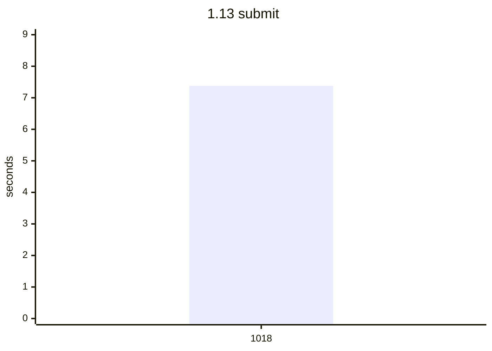
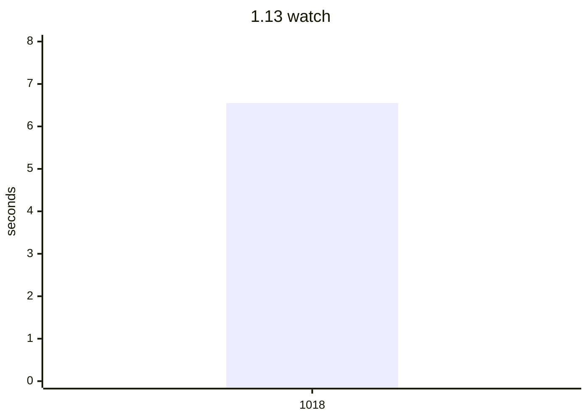
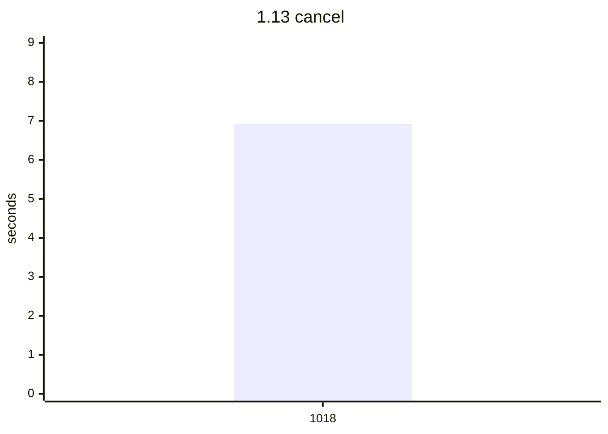
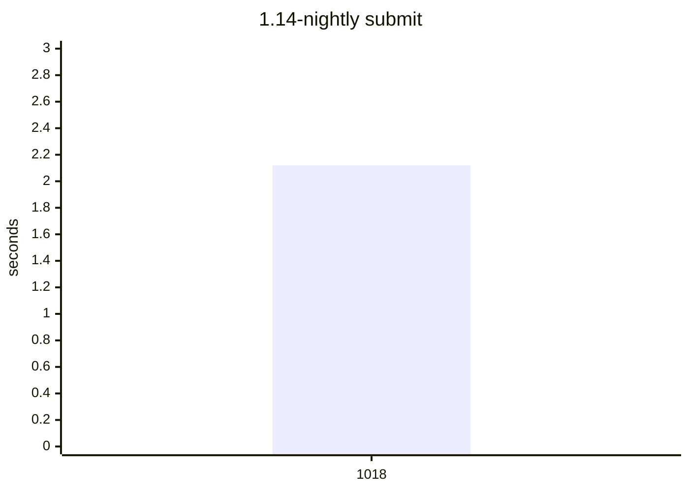
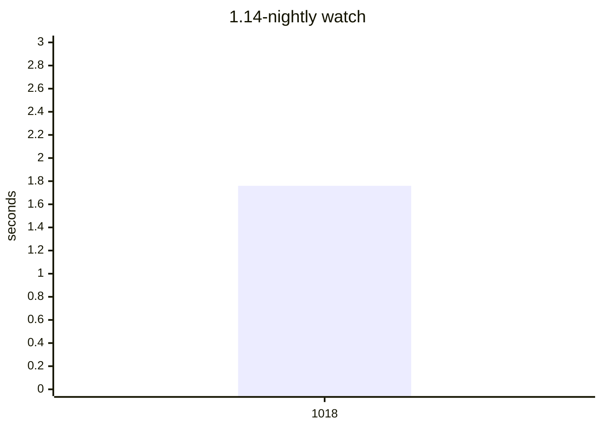
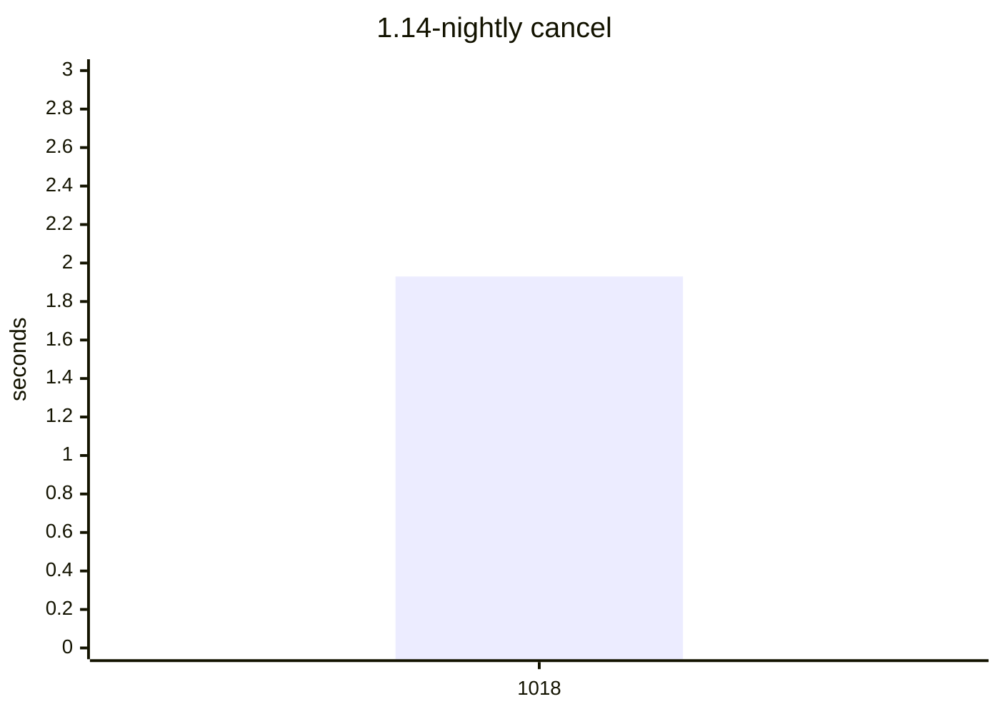
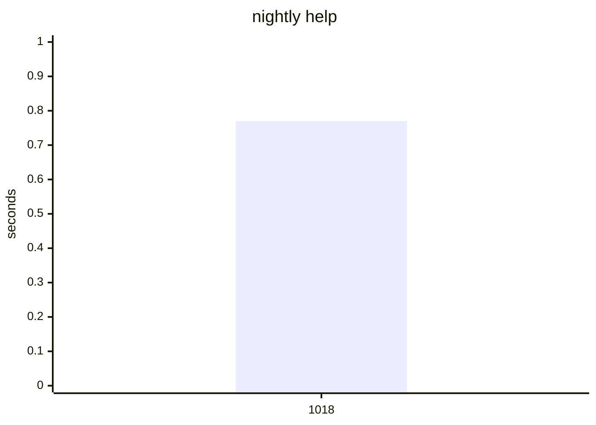
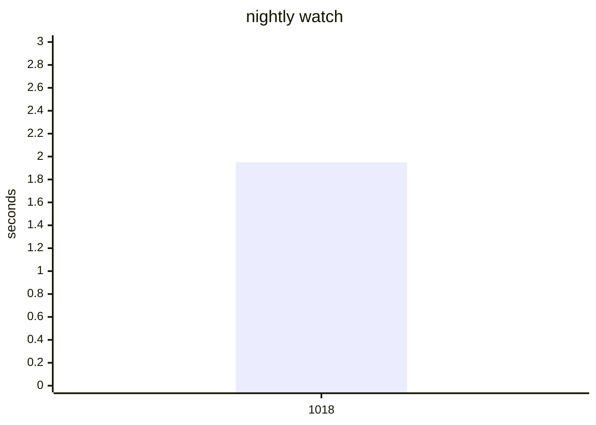
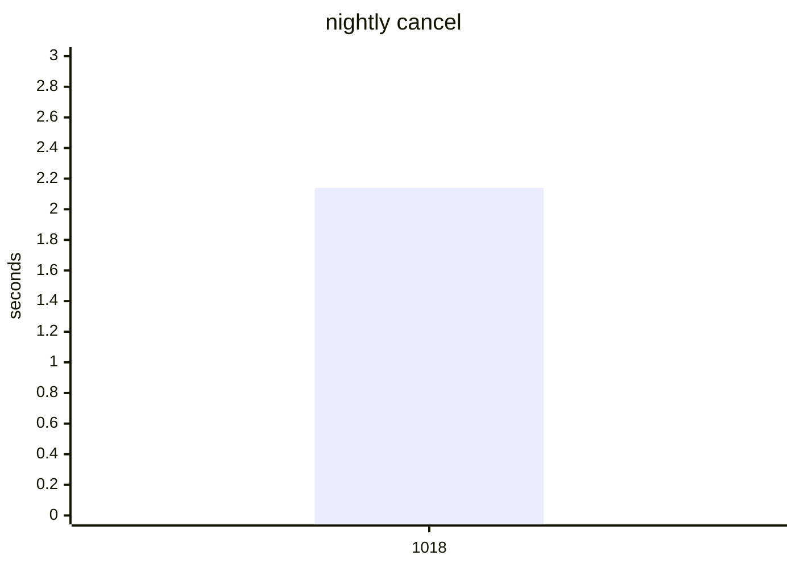

# Compile bench

Precompile time, load time, CLI wall time, `src/**/*.jl` size, and the host
(OS name, arch, CPU). `code lines` skips blank lines. A row is flagged when,
against the previous sample on the same Julia slot, the host OS or arch
changes, package precompile grows by 1.5x and 0.5s, a command wall grows
by 1.5x and 1s, or a method of at least 200 ms is new in the top 20 or
doubles. This does not fail CI.

## Flagged

- 1.13: status method new -> 4424.5 ms: Tuple{DistSSHQueue.var"#_entry_forward##0#_entry_forward##1"{DistSSHQueue.var"#_argv##0#_argv##1"{ty...
- 1.14-nightly: package precompile 0.98s -> 1.84s
- 1.14-nightly: status method 342.0 ms -> 703.5 ms: Tuple{DistSSHQueue.var"##show_status#192", Base.PipeEndpoint, Nothing, Bool, Nothing, Bool, typeof(D...
- 1.14-nightly: status method new -> 3803.2 ms: Tuple{DistSSHQueue.var"#_entry_forward##0#_entry_forward##1"{DistSSHQueue.var"#_argv##0#_argv##1"{ty...

## 1.13

| date | commit | version | os | arch | src files | code lines | full s | pkg s | using s | help s | status s | submit s | watch s | cancel s |
| --- | --- | --- | --- | --- | --- | --- | --- | --- | --- | --- | --- | --- | --- | --- |
| 2026-10-18 | 2ad75fb | 0.9.6 | Ubuntu 24.04.5 LTS | x86_64 | 24 | 6144 | 8.35 | 1.74 | 0.32 | 14.66 | 15.43 |  |  |  |
| 2026-10-18 | de4ef6e | 0.9.6 | Ubuntu 24.04.5 LTS | x86_64 | 24 | 6181 | 9.24 | 2.28 | 0.36 | 1.15 | 6.52 | 7.38 | 6.55 | 6.92 |

```mermaid
xychart-beta
    title "1.13 help"
    x-axis ["1018", "1018"]
    y-axis "seconds" 0 --> 18
    line [14.66, 1.15]
```


Latest `help` methods:

| method | now ms | previous ms |
| --- | ---: | ---: |
| `Tuple{typeof(DistSSHQueue.main), Array{String, 1}}` | 536.3 | 13902.3 |
| `Tuple{typeof(Core.kwcall), NamedTuple{(:topic,), Tuple{Nothing}}, typeof(DistSSHQueue.prin...` | 57.2 | 57.7 |
| `Tuple{Distributed.var"#start_gc_msgs_task##0#start_gc_msgs_task##1"}` | 20.2 | 20.9 |
| `Tuple{typeof(Base.should_use_main_entrypoint)}` | 11.8 | 11.3 |
| `Tuple{typeof(Core.kwcall), NamedTuple{(:topic,), Tuple{Nothing}}, typeof(DistSSHQueue.prin...` | 5.1 | 6.3 |
| `Tuple{typeof(Base.getproperty), Base.Set{String}, Symbol}` | 4.1 |  |
| `Tuple{typeof(Base._cshp), Int64, Tuple{Bool}, Tuple{}, Tuple{Int64}}` | 3.8 |  |
| `Tuple{typeof(Base.getproperty), Base.GenericCondition{Base.ReentrantLock}, Symbol}` | 3.6 |  |
| `Tuple{typeof(Base.something), Nothing, Symbol}` | 3.3 |  |

```mermaid
xychart-beta
    title "1.13 status"
    x-axis ["1018", "1018"]
    y-axis "seconds" 0 --> 19
    line [15.43, 6.52]
```


Latest `status` methods:

| method | now ms | previous ms |
| --- | ---: | ---: |
| `Tuple{DistSSHQueue.var"#_entry_forward##0#_entry_forward##1"{DistSSHQueue.var"#_argv##0#_a...` | 4424.5 |  |
| `Tuple{DistSSHQueue.var"##show_status#192", Base.PipeEndpoint, Nothing, Bool, Nothing, Bool...` | 975.4 | 628.0 |
| `Tuple{typeof(DistSSHQueue.main), Array{String, 1}}` | 519.6 | 14242.7 |
| `Tuple{Distributed.var"#start_gc_msgs_task##0#start_gc_msgs_task##1"}` | 21.1 | 19.4 |
| `Tuple{typeof(Core.kwcall), NamedTuple{(:quiet, :tail, :verbose), Tuple{Bool, Nothing, Bool...` | 14.2 | 6.9 |
| `Tuple{typeof(Base.should_use_main_entrypoint)}` | 11.6 | 11.4 |
| `Tuple{typeof(Base._array_for), Type{DistSSHQueue.Job}, Array{Any, 1}, Base.HasShape{1}}` | 7.7 | 7.9 |
| `Tuple{typeof(Base.getproperty), NamedTuple{(:quiet, :progress, :verbose, :yes, :hosts_file...` | 5.4 | 5.3 |
| `Tuple{Dates.var"##34#35", Vararg{Any, 5}}` | 5.0 | 4.7 |
| `Tuple{typeof(Base.map), Base.var"#append!##0#append!##1"{String}, NTuple{10, String}}` | 4.7 | 4.9 |




Latest `submit` methods:

| method | now ms | previous ms |
| --- | ---: | ---: |
| `Tuple{DistSSHQueue.var"#_entry_forward##0#_entry_forward##1"{DistSSHQueue.var"#_argv##0#_a...` | 5261.4 |  |
| `Tuple{typeof(Core.kwcall), NamedTuple{(:kind, :quiet, :verbosity), Tuple{Symbol, Bool, Str...` | 577.6 |  |
| `Tuple{typeof(DistSSHQueue.main), Array{String, 1}}` | 523.5 |  |
| `Tuple{typeof(Core.kwcall), NamedTuple{(:kind,), Tuple{Symbol}}, typeof(DistSSHQueue.submit...` | 116.0 |  |
| `Tuple{typeof(DistSSHQueue.script_arg), String, String}` | 96.4 |  |
| `Tuple{typeof(DistSSHQueue.reject_worker_root_collision!), Array{DistSSHQueue.Job, 1}, Stri...` | 64.3 |  |
| `Tuple{typeof(DistSSHQueue.parse_host_cap), String}` | 51.8 |  |
| `Tuple{typeof(Core.kwcall), NamedTuple{(:kind,), Tuple{Symbol}}, typeof(DistSSHQueue.submit...` | 23.8 |  |
| `Tuple{Distributed.var"#start_gc_msgs_task##0#start_gc_msgs_task##1"}` | 19.4 |  |
| `Tuple{typeof(Core.kwcall), NamedTuple{(:indent, :sorted, :by, :inline_tables), Tuple{Int64...` | 16.9 |  |




Latest `watch` methods:

| method | now ms | previous ms |
| --- | ---: | ---: |
| `Tuple{DistSSHQueue.var"#_entry_forward##0#_entry_forward##1"{DistSSHQueue.var"#_argv##0#_a...` | 4415.9 |  |
| `Tuple{DistSSHQueue.var"##watch!#196", Float64, Int64, Base.PipeEndpoint, Nothing, Bool, No...` | 983.2 |  |
| `Tuple{typeof(DistSSHQueue.main), Array{String, 1}}` | 541.3 |  |
| `Tuple{Distributed.var"#start_gc_msgs_task##0#start_gc_msgs_task##1"}` | 19.5 |  |
| `Tuple{typeof(Core.kwcall), NamedTuple{(:interval, :ticks, :quiet, :tail, :verbose), Tuple{...` | 18.1 |  |
| `Tuple{typeof(Base.should_use_main_entrypoint)}` | 13.5 |  |
| `Tuple{typeof(Base._array_for), Type{DistSSHQueue.Job}, Array{Any, 1}, Base.HasShape{1}}` | 7.6 |  |
| `Tuple{typeof(Base.getproperty), NamedTuple{(:quiet, :progress, :verbose, :yes, :hosts_file...` | 5.5 |  |
| `Tuple{typeof(Base.map), Base.var"#append!##0#append!##1"{String}, NTuple{10, String}}` | 5.0 |  |
| `Tuple{Dates.var"##34#35", Vararg{Any, 5}}` | 4.9 |  |




Latest `cancel` methods:

| method | now ms | previous ms |
| --- | ---: | ---: |
| `Tuple{DistSSHQueue.var"#_entry_forward##0#_entry_forward##1"{DistSSHQueue.var"#_argv##0#_a...` | 5472.3 |  |
| `Tuple{typeof(DistSSHQueue.main), Array{String, 1}}` | 528.3 |  |
| `Tuple{typeof(DistSSHQueue._row_dt), String, String}` | 90.6 |  |
| `Tuple{typeof(DistSSHQueue._job_row), Base.Dict{String, Any}, String}` | 62.6 |  |
| `Tuple{Type{Base.Dict{String, Any}}, Base.Generator{Base.Dict{String, Any}, DistSSHQueue.va...` | 31.0 |  |
| `Tuple{typeof(Core.kwcall), NamedTuple{(:id, :kind, :script, :hosts, :state, :queued_at, :s...` | 24.1 |  |
| `Tuple{Distributed.var"#start_gc_msgs_task##0#start_gc_msgs_task##1"}` | 20.9 |  |
| `Tuple{typeof(Core.kwcall), NamedTuple{(:indent, :sorted, :by, :inline_tables), Tuple{Int64...` | 17.7 |  |
| `Tuple{typeof(Base.iterate), Base.Dict{String, Any}}` | 12.2 |  |
| `Tuple{typeof(Base.should_use_main_entrypoint)}` | 11.7 |  |

## 1.14-nightly

| date | commit | version | os | arch | src files | code lines | full s | pkg s | using s | help s | status s | submit s | watch s | cancel s |
| --- | --- | --- | --- | --- | --- | --- | --- | --- | --- | --- | --- | --- | --- | --- |
| 2026-10-18 | 2ad75fb | 0.9.6 | Ubuntu 24.04.5 LTS | x86_64 | 24 | 6144 | 4.42 | 0.98 | 0.24 | 4.2 | 4.33 |  |  |  |
| 2026-10-18 | de4ef6e | 0.9.6 | Ubuntu 24.04.5 LTS | x86_64 | 24 | 6181 | 6.96 | 1.84 | 0.33 | 0.71 | 1.82 | 2.12 | 1.76 | 1.93 |

```mermaid
xychart-beta
    title "1.14-nightly help"
    x-axis ["1018", "1018"]
    y-axis "seconds" 0 --> 6
    line [4.2, 0.71]
```


Latest `help` methods:

| method | now ms | previous ms |
| --- | ---: | ---: |
| `Tuple{typeof(DistSSHQueue.main), Array{String, 1}}` | 418.1 | 9878.4 |
| `Tuple{typeof(Core.kwcall), NamedTuple{(:topic,), Tuple{Nothing}}, typeof(DistSSHQueue.prin...` | 46.9 | 35.0 |
| `Tuple{typeof(Distributed.flush_gc_msgs)}` | 20.0 | 14.4 |
| `Tuple{typeof(Base.should_use_main_entrypoint)}` | 16.5 | 10.8 |
| `Tuple{Distributed.var"#start_gc_msgs_task##0#start_gc_msgs_task##1"}` | 13.1 | 9.5 |
| `Tuple{typeof(Base.string), Char}` | 6.3 | 5.0 |
| `Tuple{typeof(Base.tail), NTuple{15, String}}` | 4.9 |  |
| `Tuple{typeof(Base._cshp), Int64, Tuple{Bool}, Tuple{}, Tuple{Int64}}` | 4.2 |  |
| `Tuple{typeof(Base.tail), NTuple{14, String}}` | 4.2 |  |
| `Tuple{typeof(Core.kwcall), NamedTuple{(:topic,), Tuple{Nothing}}, typeof(DistSSHQueue.prin...` | 4.2 | 4.8 |

```mermaid
xychart-beta
    title "1.14-nightly status"
    x-axis ["1018", "1018"]
    y-axis "seconds" 0 --> 6
    line [4.33, 1.82]
```


Latest `status` methods:

| method | now ms | previous ms |
| --- | ---: | ---: |
| `Tuple{DistSSHQueue.var"#_entry_forward##0#_entry_forward##1"{DistSSHQueue.var"#_argv##0#_a...` | 3803.2 |  |
| `Tuple{DistSSHQueue.var"##show_status#192", Base.PipeEndpoint, Nothing, Bool, Nothing, Bool...` | 703.5 | 342.0 |
| `Tuple{typeof(DistSSHQueue.main), Array{String, 1}}` | 205.9 | 3791.2 |
| `Tuple{typeof(Distributed.flush_gc_msgs)}` | 20.3 | 17.1 |
| `Tuple{Distributed.var"#start_gc_msgs_task##0#start_gc_msgs_task##1"}` | 13.4 | 11.2 |
| `Tuple{typeof(Core.kwcall), NamedTuple{(:quiet, :tail, :verbose), Tuple{Bool, Nothing, Bool...` | 10.3 | 10.9 |
| `Tuple{typeof(Base.getproperty), NamedTuple{(:quiet, :progress, :verbose, :yes, :hosts_file...` | 9.0 | 1.2 |
| `Tuple{typeof(Base.map), Base.var"#append!##0#append!##1"{String}, NTuple{10, String}}` | 7.6 |  |
| `Tuple{typeof(Base._array_for), Core.TypeEgal{DistSSHQueue.Job}, Array{Any, 1}, Base.HasSha...` | 6.5 | 6.7 |
| `Tuple{typeof(DistSSHQueue._q_cell), String, Int64}` | 4.6 |  |




Latest `submit` methods:

| method | now ms | previous ms |
| --- | ---: | ---: |
| `Tuple{DistSSHQueue.var"#_entry_forward##0#_entry_forward##1"{DistSSHQueue.var"#_argv##0#_a...` | 4490.4 |  |
| `Tuple{typeof(Core.kwcall), NamedTuple{(:kind, :quiet, :verbosity), Tuple{Symbol, Bool, Str...` | 442.4 |  |
| `Tuple{typeof(DistSSHQueue.main), Array{String, 1}}` | 187.4 |  |
| `Tuple{typeof(Core.kwcall), NamedTuple{(:kind,), Tuple{Symbol}}, typeof(DistSSHQueue.submit...` | 85.9 |  |
| `Tuple{typeof(DistSSHQueue.script_arg), String, String}` | 72.5 |  |
| `Tuple{typeof(DistSSHQueue.reject_worker_root_collision!), Array{DistSSHQueue.Job, 1}, Stri...` | 60.9 |  |
| `Tuple{typeof(DistSSHQueue.parse_host_cap), String}` | 40.4 |  |
| `Tuple{typeof(Distributed.flush_gc_msgs)}` | 20.1 |  |
| `Tuple{typeof(Core.kwcall), NamedTuple{(:kind,), Tuple{Symbol}}, typeof(DistSSHQueue.submit...` | 20.1 |  |
| `Tuple{Distributed.var"#start_gc_msgs_task##0#start_gc_msgs_task##1"}` | 13.3 |  |




Latest `watch` methods:

| method | now ms | previous ms |
| --- | ---: | ---: |
| `Tuple{DistSSHQueue.var"#_entry_forward##0#_entry_forward##1"{DistSSHQueue.var"#_argv##0#_a...` | 3651.0 |  |
| `Tuple{DistSSHQueue.var"##watch!#196", Float64, Int64, Base.PipeEndpoint, Nothing, Bool, No...` | 726.6 |  |
| `Tuple{typeof(DistSSHQueue.main), Array{String, 1}}` | 187.6 |  |
| `Tuple{typeof(Distributed.flush_gc_msgs)}` | 20.2 |  |
| `Tuple{typeof(Core.kwcall), NamedTuple{(:interval, :ticks, :quiet, :tail, :verbose), Tuple{...` | 14.3 |  |
| `Tuple{Distributed.var"#start_gc_msgs_task##0#start_gc_msgs_task##1"}` | 13.5 |  |
| `Tuple{Core.TypeEgal{NamedTuple{(:verb, :default_interval), T} where T<:Tuple}, Tuple{Strin...` | 7.5 |  |
| `Tuple{Base.var"##187#188", Vararg{Any, 4}}` | 3.4 |  |
| `Tuple{typeof(Base.should_use_main_entrypoint)}` | 3.1 |  |
| `Tuple{typeof(Base._array_for), Core.TypeEgal{DistSSHQueue.Job}, Array{Any, 1}, Base.HasSha...` | 1.9 |  |




Latest `cancel` methods:

| method | now ms | previous ms |
| --- | ---: | ---: |
| `Tuple{DistSSHQueue.var"#_entry_forward##0#_entry_forward##1"{DistSSHQueue.var"#_argv##0#_a...` | 4479.4 |  |
| `Tuple{typeof(DistSSHQueue.main), Array{String, 1}}` | 196.0 |  |
| `Tuple{typeof(DistSSHQueue._job_row), Base.Dict{String, Any}, String}` | 167.8 |  |
| `Tuple{typeof(DistSSHQueue._row_dt), String, String}` | 70.3 |  |
| `Tuple{Core.TypeEgal{Base.Dict{String, Any}}, Base.Generator{Base.Dict{String, Any}, DistSS...` | 25.7 |  |
| `Tuple{typeof(Distributed.flush_gc_msgs)}` | 20.3 |  |
| `Tuple{typeof(Core.kwcall), NamedTuple{(:id, :kind, :script, :hosts, :state, :queued_at, :s...` | 19.1 |  |
| `Tuple{Core.TypeEgal{Base.Dict{String, Any}}, Pair{String, String}, Pair{String, String}, P...` | 13.5 |  |
| `Tuple{Distributed.var"#start_gc_msgs_task##0#start_gc_msgs_task##1"}` | 13.3 |  |
| `Tuple{typeof(Base.iterate), Base.Dict{String, Any}}` | 11.9 |  |

## nightly

| date | commit | version | os | arch | src files | code lines | full s | pkg s | using s | help s | status s | submit s | watch s | cancel s |
| --- | --- | --- | --- | --- | --- | --- | --- | --- | --- | --- | --- | --- | --- | --- |
| 2026-10-18 | de4ef6e | 0.9.6 | Ubuntu 24.04.5 LTS | x86_64 | 24 | 6181 | 7.99 | 2.09 | 0.35 | 0.77 | 2.0 | 2.24 | 1.95 | 2.14 |




Latest `help` methods:

| method | now ms | previous ms |
| --- | ---: | ---: |
| `Tuple{typeof(DistSSHQueue.main), Array{String, 1}}` | 455.3 |  |
| `Tuple{typeof(Core.kwcall), NamedTuple{(:topic,), Tuple{Nothing}}, typeof(DistSSHQueue.prin...` | 50.9 |  |
| `Tuple{typeof(Distributed.flush_gc_msgs)}` | 22.0 |  |
| `Tuple{typeof(Base.should_use_main_entrypoint)}` | 15.0 |  |
| `Tuple{Distributed.var"#start_gc_msgs_task##0#start_gc_msgs_task##1"}` | 14.0 |  |
| `Tuple{typeof(Base.string), Char}` | 6.2 |  |
| `Tuple{typeof(Base.tail), NTuple{15, String}}` | 4.5 |  |
| `Tuple{typeof(Base._cshp), Int64, Tuple{Bool}, Tuple{}, Tuple{Int64}}` | 4.3 |  |
| `Tuple{typeof(Core.kwcall), NamedTuple{(:topic,), Tuple{Nothing}}, typeof(DistSSHQueue.prin...` | 4.1 |  |
| `Tuple{typeof(Base.tail), NTuple{14, String}}` | 4.0 |  |


Latest `status` methods:

| method | now ms | previous ms |
| --- | ---: | ---: |
| `Tuple{DistSSHQueue.var"#_entry_forward##0#_entry_forward##1"{DistSSHQueue.var"#_argv##0#_a...` | 4199.3 |  |
| `Tuple{DistSSHQueue.var"##show_status#192", Base.PipeEndpoint, Nothing, Bool, Nothing, Bool...` | 784.9 |  |
| `Tuple{typeof(DistSSHQueue.main), Array{String, 1}}` | 203.3 |  |
| `Tuple{typeof(Distributed.flush_gc_msgs)}` | 23.3 |  |
| `Tuple{Distributed.var"#start_gc_msgs_task##0#start_gc_msgs_task##1"}` | 14.4 |  |
| `Tuple{typeof(Core.kwcall), NamedTuple{(:quiet, :tail, :verbose), Tuple{Bool, Nothing, Bool...` | 10.7 |  |
| `Tuple{typeof(Base.getproperty), NamedTuple{(:quiet, :progress, :verbose, :yes, :hosts_file...` | 8.7 |  |
| `Tuple{typeof(Base._array_for), Core.TypeEgal{DistSSHQueue.Job}, Array{Any, 1}, Base.HasSha...` | 7.0 |  |
| `Tuple{typeof(Base.map), Base.var"#append!##0#append!##1"{String}, NTuple{10, String}}` | 6.9 |  |
| `Tuple{typeof(DistSSHQueue._q_cell), String, Int64}` | 5.0 |  |


Latest `submit` methods:

| method | now ms | previous ms |
| --- | ---: | ---: |
| `Tuple{DistSSHQueue.var"#_entry_forward##0#_entry_forward##1"{DistSSHQueue.var"#_argv##0#_a...` | 5069.4 |  |
| `Tuple{typeof(Core.kwcall), NamedTuple{(:kind, :quiet, :verbosity), Tuple{Symbol, Bool, Str...` | 491.7 |  |
| `Tuple{typeof(DistSSHQueue.main), Array{String, 1}}` | 212.0 |  |
| `Tuple{typeof(Core.kwcall), NamedTuple{(:kind,), Tuple{Symbol}}, typeof(DistSSHQueue.submit...` | 94.5 |  |
| `Tuple{typeof(DistSSHQueue.script_arg), String, String}` | 80.8 |  |
| `Tuple{typeof(DistSSHQueue.reject_worker_root_collision!), Array{DistSSHQueue.Job, 1}, Stri...` | 66.8 |  |
| `Tuple{typeof(DistSSHQueue.parse_host_cap), String}` | 45.8 |  |
| `Tuple{typeof(Distributed.flush_gc_msgs)}` | 22.7 |  |
| `Tuple{typeof(Core.kwcall), NamedTuple{(:kind,), Tuple{Symbol}}, typeof(DistSSHQueue.submit...` | 20.5 |  |
| `Tuple{Distributed.var"#start_gc_msgs_task##0#start_gc_msgs_task##1"}` | 14.1 |  |




Latest `watch` methods:

| method | now ms | previous ms |
| --- | ---: | ---: |
| `Tuple{DistSSHQueue.var"#_entry_forward##0#_entry_forward##1"{DistSSHQueue.var"#_argv##0#_a...` | 4086.9 |  |
| `Tuple{DistSSHQueue.var"##watch!#196", Float64, Int64, Base.PipeEndpoint, Nothing, Bool, No...` | 753.0 |  |
| `Tuple{typeof(DistSSHQueue.main), Array{String, 1}}` | 214.5 |  |
| `Tuple{typeof(Base._array_for), Core.TypeEgal{DistSSHQueue.Job}, Array{Any, 1}, Base.HasSha...` | 37.3 |  |
| `Tuple{typeof(Distributed.flush_gc_msgs)}` | 22.8 |  |
| `Tuple{typeof(Core.kwcall), NamedTuple{(:interval, :ticks, :quiet, :tail, :verbose), Tuple{...` | 15.2 |  |
| `Tuple{Distributed.var"#start_gc_msgs_task##0#start_gc_msgs_task##1"}` | 14.9 |  |
| `Tuple{Core.TypeEgal{NamedTuple{(:verb, :default_interval), T} where T<:Tuple}, Tuple{Strin...` | 6.6 |  |
| `Tuple{Base.var"##187#188", Vararg{Any, 4}}` | 3.8 |  |
| `Tuple{typeof(Base.should_use_main_entrypoint)}` | 2.8 |  |




Latest `cancel` methods:

| method | now ms | previous ms |
| --- | ---: | ---: |
| `Tuple{DistSSHQueue.var"#_entry_forward##0#_entry_forward##1"{DistSSHQueue.var"#_argv##0#_a...` | 5126.5 |  |
| `Tuple{typeof(DistSSHQueue.main), Array{String, 1}}` | 212.5 |  |
| `Tuple{typeof(DistSSHQueue._job_row), Base.Dict{String, Any}, String}` | 198.1 |  |
| `Tuple{typeof(DistSSHQueue._row_dt), String, String}` | 83.8 |  |
| `Tuple{Core.TypeEgal{Base.Dict{String, Any}}, Base.Generator{Base.Dict{String, Any}, DistSS...` | 28.8 |  |
| `Tuple{typeof(Distributed.flush_gc_msgs)}` | 23.7 |  |
| `Tuple{typeof(Core.kwcall), NamedTuple{(:id, :kind, :script, :hosts, :state, :queued_at, :s...` | 21.8 |  |
| `Tuple{Core.TypeEgal{Base.Dict{String, Any}}, Pair{String, String}, Pair{String, String}, P...` | 15.3 |  |
| `Tuple{Distributed.var"#start_gc_msgs_task##0#start_gc_msgs_task##1"}` | 14.9 |  |
| `Tuple{typeof(Base.iterate), Base.Dict{String, Any}}` | 12.4 |  |

