# Compile bench

Precompile time, load time, CLI wall time, `src/**/*.jl` size, and the host
(OS name, arch, CPU). `code lines` skips blank lines. A row is flagged when,
against the previous sample on the same Julia slot, the host OS or arch
changes, the Julia version changes, package precompile grows by 1.5x and 0.5s, a command wall grows
by 1.5x and 1s, or a method of at least 200 ms is new in the top 20 or
doubles. This does not fail CI.

## Flagged

- 1.13: status method new -> 4424.5 ms: Tuple{DistSSHQueue.var"#_entry_forward##0#_entry_forward##1"{DistSSHQueue.var"#_argv##0#_argv##1"{ty...
- 1.14-nightly: status method new -> 542.1 ms: Tuple{DistSSHQueue.var"##show_status#195", Base.PipeEndpoint, Nothing, Bool, Nothing, Bool, typeof(D...
- 1.14-nightly: watch method new -> 597.0 ms: Tuple{DistSSHQueue.var"##watch!#199", Float64, Int64, Base.PipeEndpoint, Nothing, Bool, Nothing, Boo...
- nightly: julia 1.14.0-DEV.3787 -> 1.15.0-DEV.18
- nightly: status method new -> 786.2 ms: Tuple{DistSSHQueue.var"##show_status#195", Base.PipeEndpoint, Nothing, Bool, Nothing, Bool, typeof(D...
- nightly: watch method new -> 816.1 ms: Tuple{DistSSHQueue.var"##watch!#199", Float64, Int64, Base.PipeEndpoint, Nothing, Bool, Nothing, Boo...

## 1.13

| date | commit | version | julia | os | arch | src files | code lines | full s | pkg s | using s | help s | status s | submit s | watch s | cancel s |
| --- | --- | --- | --- | --- | --- | --- | --- | --- | --- | --- | --- | --- | --- | --- | --- |
| 2026-10-18 | 2ad75fb | 0.9.6 | 1.13.2 | Ubuntu 24.04.5 LTS | x86_64 | 24 | 6144 | 8.35 | 1.74 | 0.32 | 14.66 | 15.43 |  |  |  |
| 2026-10-18 | de4ef6e | 0.9.6 | 1.13.2 | Ubuntu 24.04.5 LTS | x86_64 | 24 | 6181 | 9.24 | 2.28 | 0.36 | 1.15 | 6.52 | 7.38 | 6.55 | 6.92 |

```mermaid
---
config:
  theme: base
  themeVariables:
    xyChart:
      plotColorPalette: "#1f4e79"
  xyChart:
    xAxis:
      labelRotation: 45
---
xychart-beta
    title "1.13 help"
    x-axis ["10-18 2ad75fb", "10-18 de4ef6e"]
    y-axis "seconds" 0 --> 18
    line [14.66, 1.15]
```


Latest `help` methods:

| method | now ms | previous ms |
| --- | ---: | ---: |
| `Tuple{typeof(DistSSHQueue.main), Array{String, 1}}` | 536.3 | 13902.3 |
| `Tuple{typeof(Core.kwcall), NamedTuple{(:topic,), Tuple{Nothing}}, typeof(DistSSHQueue.prin...` | 57.2 | 57.7 |
| `Tuple{Distributed.var"#start_gc_msgs_task##0#start_gc_msgs_task##1"}` | 20.2 | 20.9 |
| `Tuple{typeof(Base.should_use_main_entrypoint)}` | 11.8 | 11.3 |
| `Tuple{typeof(Core.kwcall), NamedTuple{(:topic,), Tuple{Nothing}}, typeof(DistSSHQueue.prin...` | 5.1 | 6.3 |
| `Tuple{typeof(Base.getproperty), Base.Set{String}, Symbol}` | 4.1 |  |
| `Tuple{typeof(Base._cshp), Int64, Tuple{Bool}, Tuple{}, Tuple{Int64}}` | 3.8 |  |
| `Tuple{typeof(Base.getproperty), Base.GenericCondition{Base.ReentrantLock}, Symbol}` | 3.6 |  |
| `Tuple{typeof(Base.something), Nothing, Symbol}` | 3.3 |  |

```mermaid
---
config:
  theme: base
  themeVariables:
    xyChart:
      plotColorPalette: "#1f4e79"
  xyChart:
    xAxis:
      labelRotation: 45
---
xychart-beta
    title "1.13 status"
    x-axis ["10-18 2ad75fb", "10-18 de4ef6e"]
    y-axis "seconds" 0 --> 19
    line [15.43, 6.52]
```


Latest `status` methods:

| method | now ms | previous ms |
| --- | ---: | ---: |
| `Tuple{DistSSHQueue.var"#_entry_forward##0#_entry_forward##1"{DistSSHQueue.var"#_argv##0#_a...` | 4424.5 |  |
| `Tuple{DistSSHQueue.var"##show_status#192", Base.PipeEndpoint, Nothing, Bool, Nothing, Bool...` | 975.4 | 628.0 |
| `Tuple{typeof(DistSSHQueue.main), Array{String, 1}}` | 519.6 | 14242.7 |
| `Tuple{Distributed.var"#start_gc_msgs_task##0#start_gc_msgs_task##1"}` | 21.1 | 19.4 |
| `Tuple{typeof(Core.kwcall), NamedTuple{(:quiet, :tail, :verbose), Tuple{Bool, Nothing, Bool...` | 14.2 | 6.9 |
| `Tuple{typeof(Base.should_use_main_entrypoint)}` | 11.6 | 11.4 |
| `Tuple{typeof(Base._array_for), Type{DistSSHQueue.Job}, Array{Any, 1}, Base.HasShape{1}}` | 7.7 | 7.9 |
| `Tuple{typeof(Base.getproperty), NamedTuple{(:quiet, :progress, :verbose, :yes, :hosts_file...` | 5.4 | 5.3 |
| `Tuple{Dates.var"##34#35", Vararg{Any, 5}}` | 5.0 | 4.7 |
| `Tuple{typeof(Base.map), Base.var"#append!##0#append!##1"{String}, NTuple{10, String}}` | 4.7 | 4.9 |


Latest `submit` methods:

| method | now ms | previous ms |
| --- | ---: | ---: |
| `Tuple{DistSSHQueue.var"#_entry_forward##0#_entry_forward##1"{DistSSHQueue.var"#_argv##0#_a...` | 5261.4 |  |
| `Tuple{typeof(Core.kwcall), NamedTuple{(:kind, :quiet, :verbosity), Tuple{Symbol, Bool, Str...` | 577.6 |  |
| `Tuple{typeof(DistSSHQueue.main), Array{String, 1}}` | 523.5 |  |
| `Tuple{typeof(Core.kwcall), NamedTuple{(:kind,), Tuple{Symbol}}, typeof(DistSSHQueue.submit...` | 116.0 |  |
| `Tuple{typeof(DistSSHQueue.script_arg), String, String}` | 96.4 |  |
| `Tuple{typeof(DistSSHQueue.reject_worker_root_collision!), Array{DistSSHQueue.Job, 1}, Stri...` | 64.3 |  |
| `Tuple{typeof(DistSSHQueue.parse_host_cap), String}` | 51.8 |  |
| `Tuple{typeof(Core.kwcall), NamedTuple{(:kind,), Tuple{Symbol}}, typeof(DistSSHQueue.submit...` | 23.8 |  |
| `Tuple{Distributed.var"#start_gc_msgs_task##0#start_gc_msgs_task##1"}` | 19.4 |  |
| `Tuple{typeof(Core.kwcall), NamedTuple{(:indent, :sorted, :by, :inline_tables), Tuple{Int64...` | 16.9 |  |

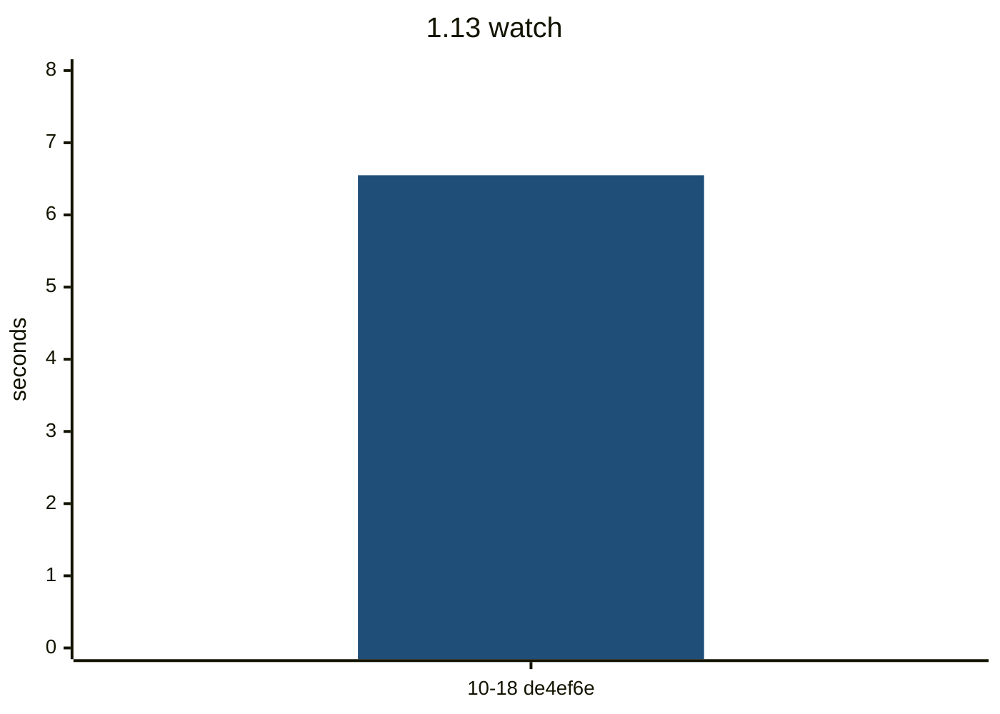


Latest `watch` methods:

| method | now ms | previous ms |
| --- | ---: | ---: |
| `Tuple{DistSSHQueue.var"#_entry_forward##0#_entry_forward##1"{DistSSHQueue.var"#_argv##0#_a...` | 4415.9 |  |
| `Tuple{DistSSHQueue.var"##watch!#196", Float64, Int64, Base.PipeEndpoint, Nothing, Bool, No...` | 983.2 |  |
| `Tuple{typeof(DistSSHQueue.main), Array{String, 1}}` | 541.3 |  |
| `Tuple{Distributed.var"#start_gc_msgs_task##0#start_gc_msgs_task##1"}` | 19.5 |  |
| `Tuple{typeof(Core.kwcall), NamedTuple{(:interval, :ticks, :quiet, :tail, :verbose), Tuple{...` | 18.1 |  |
| `Tuple{typeof(Base.should_use_main_entrypoint)}` | 13.5 |  |
| `Tuple{typeof(Base._array_for), Type{DistSSHQueue.Job}, Array{Any, 1}, Base.HasShape{1}}` | 7.6 |  |
| `Tuple{typeof(Base.getproperty), NamedTuple{(:quiet, :progress, :verbose, :yes, :hosts_file...` | 5.5 |  |
| `Tuple{typeof(Base.map), Base.var"#append!##0#append!##1"{String}, NTuple{10, String}}` | 5.0 |  |
| `Tuple{Dates.var"##34#35", Vararg{Any, 5}}` | 4.9 |  |

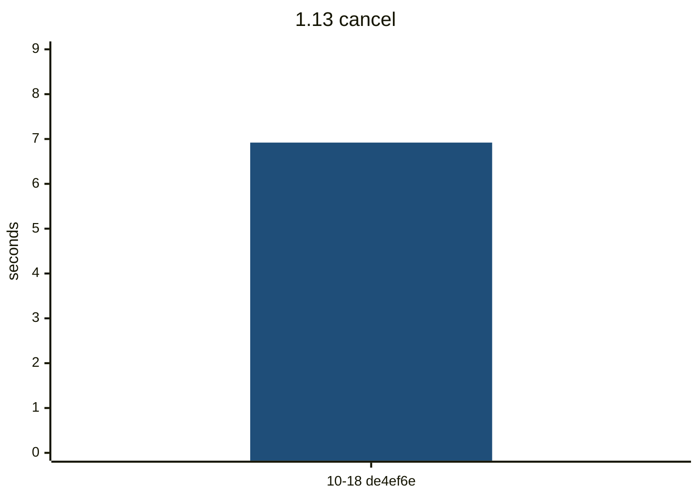


Latest `cancel` methods:

| method | now ms | previous ms |
| --- | ---: | ---: |
| `Tuple{DistSSHQueue.var"#_entry_forward##0#_entry_forward##1"{DistSSHQueue.var"#_argv##0#_a...` | 5472.3 |  |
| `Tuple{typeof(DistSSHQueue.main), Array{String, 1}}` | 528.3 |  |
| `Tuple{typeof(DistSSHQueue._row_dt), String, String}` | 90.6 |  |
| `Tuple{typeof(DistSSHQueue._job_row), Base.Dict{String, Any}, String}` | 62.6 |  |
| `Tuple{Type{Base.Dict{String, Any}}, Base.Generator{Base.Dict{String, Any}, DistSSHQueue.va...` | 31.0 |  |
| `Tuple{typeof(Core.kwcall), NamedTuple{(:id, :kind, :script, :hosts, :state, :queued_at, :s...` | 24.1 |  |
| `Tuple{Distributed.var"#start_gc_msgs_task##0#start_gc_msgs_task##1"}` | 20.9 |  |
| `Tuple{typeof(Core.kwcall), NamedTuple{(:indent, :sorted, :by, :inline_tables), Tuple{Int64...` | 17.7 |  |
| `Tuple{typeof(Base.iterate), Base.Dict{String, Any}}` | 12.2 |  |
| `Tuple{typeof(Base.should_use_main_entrypoint)}` | 11.7 |  |

## 1.14-nightly

| date | commit | version | julia | os | arch | src files | code lines | full s | pkg s | using s | help s | status s | submit s | watch s | cancel s |
| --- | --- | --- | --- | --- | --- | --- | --- | --- | --- | --- | --- | --- | --- | --- | --- |
| 2026-10-18 | 2ad75fb | 0.9.6 | 1.14.0-DEV.3787 | Ubuntu 24.04.5 LTS | x86_64 | 24 | 6144 | 4.42 | 0.98 | 0.24 | 4.2 | 4.33 |  |  |  |
| 2026-10-18 | de4ef6e | 0.9.6 | 1.14.0-DEV.3787 | Ubuntu 24.04.5 LTS | x86_64 | 24 | 6181 | 6.96 | 1.84 | 0.33 | 0.71 | 1.82 | 2.12 | 1.76 | 1.93 |
| 2026-10-19 | 860266c | 0.9.6 | 1.14.0-DEV.3787 | Ubuntu 24.04.5 LTS | x86_64 | 24 | 6182 | 5.19 | 1.35 | 0.26 | 0.62 | 1.44 | 1.67 | 1.47 | 1.51 |

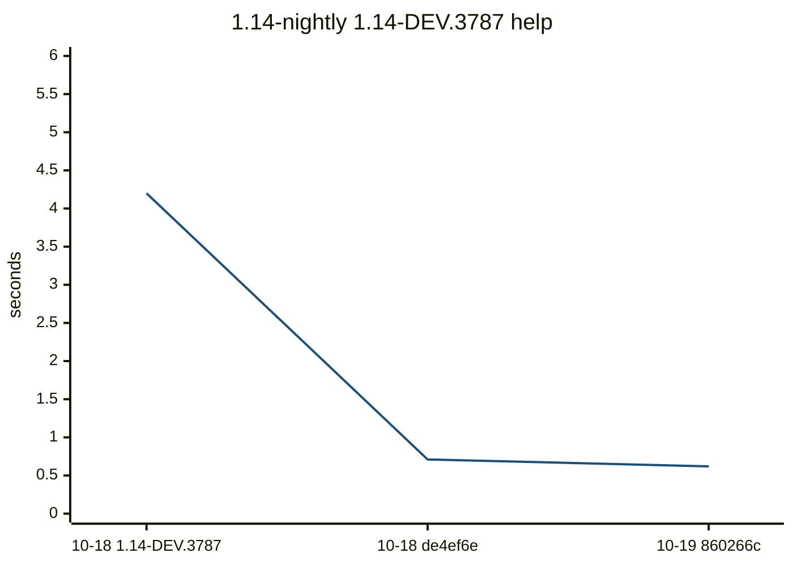


Latest `help` methods:

| method | now ms | previous ms |
| --- | ---: | ---: |
| `Tuple{typeof(DistSSHQueue.main), Array{String, 1}}` | 352.9 | 418.1 |
| `Tuple{typeof(Core.kwcall), NamedTuple{(:topic,), Tuple{Nothing}}, typeof(DistSSHQueue.prin...` | 39.2 | 46.9 |
| `Tuple{typeof(Distributed.flush_gc_msgs)}` | 18.1 | 20.0 |
| `Tuple{Distributed.var"#start_gc_msgs_task##0#start_gc_msgs_task##1"}` | 12.3 | 13.1 |
| `Tuple{typeof(Base.should_use_main_entrypoint)}` | 12.1 | 16.5 |
| `Tuple{typeof(Base.string), Char}` | 6.1 | 6.3 |
| `Tuple{typeof(Base.tail), NTuple{15, String}}` | 5.1 | 4.9 |
| `Tuple{typeof(Core.kwcall), NamedTuple{(:topic,), Tuple{Nothing}}, typeof(DistSSHQueue.prin...` | 4.7 | 4.2 |
| `Tuple{typeof(Base._cshp), Int64, Tuple{Bool}, Tuple{}, Tuple{Int64}}` | 3.9 | 4.2 |
| `Tuple{typeof(Base.tail), NTuple{14, String}}` | 3.9 | 4.2 |

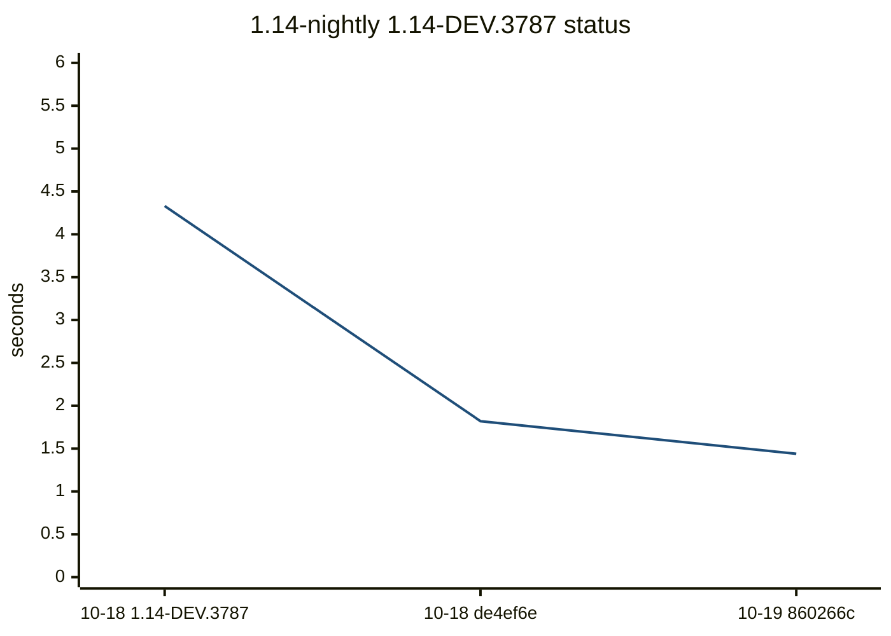


Latest `status` methods:

| method | now ms | previous ms |
| --- | ---: | ---: |
| `Tuple{DistSSHQueue.var"#_entry_forward##0#_entry_forward##1"{DistSSHQueue.var"#_argv##0#_a...` | 2997.6 | 3803.2 |
| `Tuple{DistSSHQueue.var"##show_status#195", Base.PipeEndpoint, Nothing, Bool, Nothing, Bool...` | 542.1 |  |
| `Tuple{typeof(DistSSHQueue.main), Array{String, 1}}` | 172.1 | 205.9 |
| `Tuple{Base.var"##187#188", Vararg{Any, 4}}` | 40.1 |  |
| `Tuple{typeof(Distributed.flush_gc_msgs)}` | 17.7 | 20.3 |
| `Tuple{Distributed.var"#start_gc_msgs_task##0#start_gc_msgs_task##1"}` | 11.5 | 13.4 |
| `Tuple{typeof(Core.kwcall), NamedTuple{(:quiet, :tail, :verbose), Tuple{Bool, Nothing, Bool...` | 9.3 | 10.3 |
| `Tuple{typeof(Base.getproperty), NamedTuple{(:quiet, :progress, :verbose, :yes, :hosts_file...` | 7.8 | 9.0 |
| `Tuple{typeof(Base.map), Base.var"#append!##0#append!##1"{String}, NTuple{10, String}}` | 6.4 | 7.6 |
| `Tuple{typeof(Base._array_for), Core.TypeEgal{DistSSHQueue.Job}, Array{Any, 1}, Base.HasSha...` | 6.2 | 6.5 |

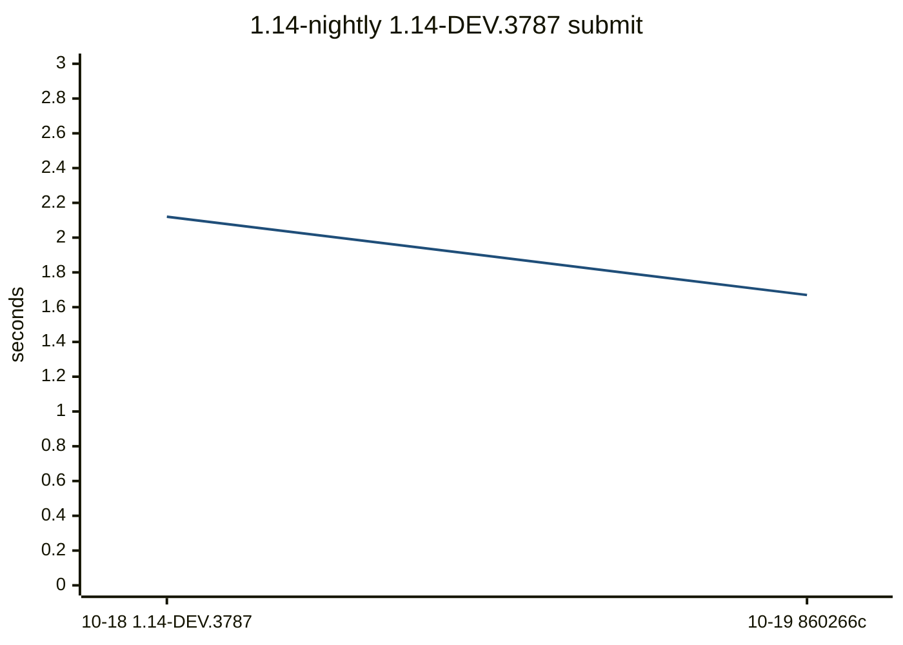


Latest `submit` methods:

| method | now ms | previous ms |
| --- | ---: | ---: |
| `Tuple{DistSSHQueue.var"#_entry_forward##0#_entry_forward##1"{DistSSHQueue.var"#_argv##0#_a...` | 3624.4 | 4490.4 |
| `Tuple{typeof(Core.kwcall), NamedTuple{(:kind, :quiet, :verbosity), Tuple{Symbol, Bool, Str...` | 345.9 | 442.4 |
| `Tuple{typeof(DistSSHQueue.main), Array{String, 1}}` | 167.7 | 187.4 |
| `Tuple{typeof(Core.kwcall), NamedTuple{(:kind,), Tuple{Symbol}}, typeof(DistSSHQueue.submit...` | 72.1 | 85.9 |
| `Tuple{typeof(DistSSHQueue.script_arg), String, String}` | 56.8 | 72.5 |
| `Tuple{typeof(DistSSHQueue.reject_worker_root_collision!), Array{DistSSHQueue.Job, 1}, Stri...` | 46.9 | 60.9 |
| `Tuple{typeof(DistSSHQueue.parse_host_cap), String}` | 33.5 | 40.4 |
| `Tuple{typeof(Distributed.flush_gc_msgs)}` | 17.5 | 20.1 |
| `Tuple{typeof(Core.kwcall), NamedTuple{(:kind,), Tuple{Symbol}}, typeof(DistSSHQueue.submit...` | 17.1 | 20.1 |
| `Tuple{Distributed.var"#start_gc_msgs_task##0#start_gc_msgs_task##1"}` | 11.6 | 13.3 |

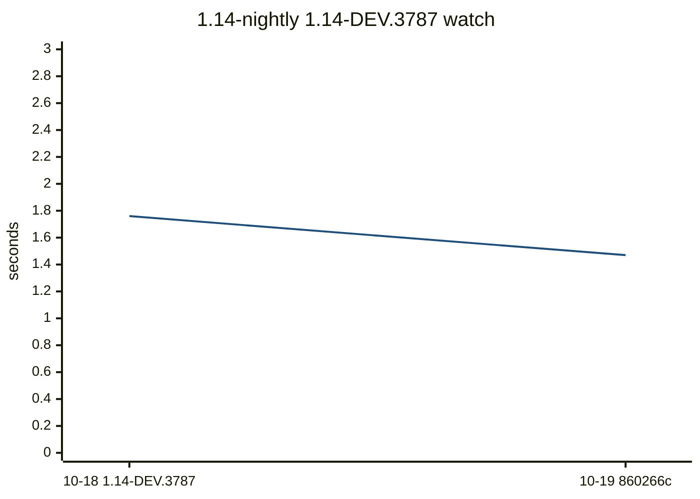


Latest `watch` methods:

| method | now ms | previous ms |
| --- | ---: | ---: |
| `Tuple{DistSSHQueue.var"#_entry_forward##0#_entry_forward##1"{DistSSHQueue.var"#_argv##0#_a...` | 2898.8 | 3651.0 |
| `Tuple{DistSSHQueue.var"##watch!#199", Float64, Int64, Base.PipeEndpoint, Nothing, Bool, No...` | 597.0 |  |
| `Tuple{typeof(DistSSHQueue.main), Array{String, 1}}` | 172.1 | 187.6 |
| `Tuple{typeof(Distributed.flush_gc_msgs)}` | 18.2 | 20.2 |
| `Tuple{typeof(Core.kwcall), NamedTuple{(:interval, :ticks, :quiet, :tail, :verbose), Tuple{...` | 12.6 | 14.3 |
| `Tuple{Distributed.var"#start_gc_msgs_task##0#start_gc_msgs_task##1"}` | 12.2 | 13.5 |
| `Tuple{Core.TypeEgal{NamedTuple{(:verb, :default_interval), T} where T<:Tuple}, Tuple{Strin...` | 6.2 | 7.5 |
| `Tuple{typeof(Base.should_use_main_entrypoint)}` | 3.0 | 3.1 |
| `Tuple{Base.var"##187#188", Vararg{Any, 4}}` | 2.9 | 3.4 |
| `Tuple{typeof(Base._array_for), Core.TypeEgal{DistSSHQueue.Job}, Array{Any, 1}, Base.HasSha...` | 1.8 | 1.9 |

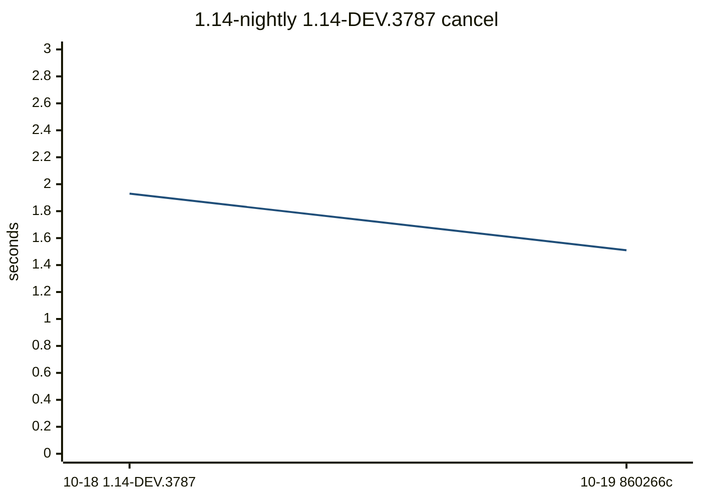


Latest `cancel` methods:

| method | now ms | previous ms |
| --- | ---: | ---: |
| `Tuple{DistSSHQueue.var"#_entry_forward##0#_entry_forward##1"{DistSSHQueue.var"#_argv##0#_a...` | 3560.7 | 4479.4 |
| `Tuple{typeof(DistSSHQueue.main), Array{String, 1}}` | 162.5 | 196.0 |
| `Tuple{typeof(DistSSHQueue._job_row), Base.Dict{String, Any}, String}` | 116.8 | 167.8 |
| `Tuple{typeof(DistSSHQueue._row_dt), String, String}` | 52.0 | 70.3 |
| `Tuple{Core.TypeEgal{Base.Dict{String, Any}}, Base.Generator{Base.Dict{String, Any}, DistSS...` | 21.3 | 25.7 |
| `Tuple{typeof(Distributed.flush_gc_msgs)}` | 17.6 | 20.3 |
| `Tuple{typeof(Core.kwcall), NamedTuple{(:id, :kind, :script, :hosts, :state, :queued_at, :s...` | 17.5 | 19.1 |
| `Tuple{Core.TypeEgal{Base.Dict{String, Any}}, Pair{String, String}, Pair{String, String}, P...` | 12.5 | 13.5 |
| `Tuple{Distributed.var"#start_gc_msgs_task##0#start_gc_msgs_task##1"}` | 11.6 | 13.3 |
| `Tuple{typeof(Base.iterate), Base.Dict{String, Any}}` | 10.1 | 11.9 |

## nightly

| date | commit | version | julia | os | arch | src files | code lines | full s | pkg s | using s | help s | status s | submit s | watch s | cancel s |
| --- | --- | --- | --- | --- | --- | --- | --- | --- | --- | --- | --- | --- | --- | --- | --- |
| 2026-10-18 | de4ef6e | 0.9.6 | 1.14.0-DEV.3787 | Ubuntu 24.04.5 LTS | x86_64 | 24 | 6181 | 7.99 | 2.09 | 0.35 | 0.77 | 2.0 | 2.24 | 1.95 | 2.14 |
| 2026-10-19 | 860266c | 0.9.6 | 1.15.0-DEV.18 | Ubuntu 24.04.5 LTS | x86_64 | 24 | 6182 | 8.26 | 2.12 | 0.35 | 0.77 | 2.05 | 2.3 | 2.03 | 2.13 |

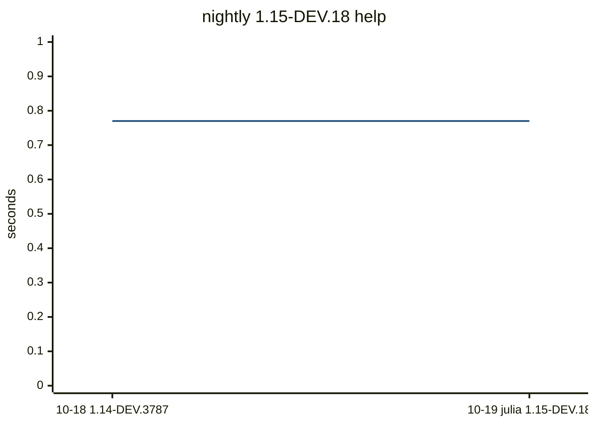


Latest `help` methods:

| method | now ms | previous ms |
| --- | ---: | ---: |
| `Tuple{typeof(DistSSHQueue.main), Array{String, 1}}` | 473.7 | 455.3 |
| `Tuple{typeof(Core.kwcall), NamedTuple{(:topic,), Tuple{Nothing}}, typeof(DistSSHQueue.prin...` | 52.2 | 50.9 |
| `Tuple{typeof(Distributed.flush_gc_msgs)}` | 23.0 | 22.0 |
| `Tuple{typeof(Base.should_use_main_entrypoint)}` | 15.5 | 15.0 |
| `Tuple{Distributed.var"#start_gc_msgs_task##0#start_gc_msgs_task##1"}` | 14.8 | 14.0 |
| `Tuple{typeof(Base.string), Char}` | 6.5 | 6.2 |
| `Tuple{typeof(Base.tail), NTuple{15, String}}` | 5.3 | 4.5 |
| `Tuple{typeof(Core.kwcall), NamedTuple{(:topic,), Tuple{Nothing}}, typeof(DistSSHQueue.prin...` | 4.7 | 4.1 |
| `Tuple{typeof(Base.tail), NTuple{12, String}}` | 4.1 | 3.8 |
| `Tuple{typeof(Base.tail), NTuple{13, String}}` | 4.0 | 3.8 |

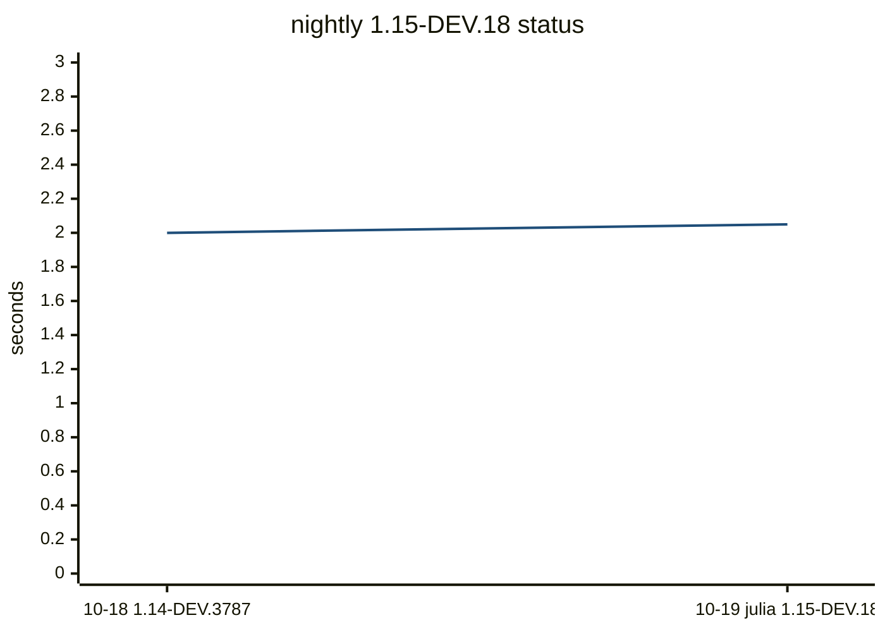


Latest `status` methods:

| method | now ms | previous ms |
| --- | ---: | ---: |
| `Tuple{DistSSHQueue.var"#_entry_forward##0#_entry_forward##1"{DistSSHQueue.var"#_argv##0#_a...` | 4318.7 | 4199.3 |
| `Tuple{DistSSHQueue.var"##show_status#195", Base.PipeEndpoint, Nothing, Bool, Nothing, Bool...` | 786.2 |  |
| `Tuple{typeof(DistSSHQueue.main), Array{String, 1}}` | 213.4 | 203.3 |
| `Tuple{typeof(Distributed.flush_gc_msgs)}` | 22.2 | 23.3 |
| `Tuple{Distributed.var"#start_gc_msgs_task##0#start_gc_msgs_task##1"}` | 14.1 | 14.4 |
| `Tuple{typeof(Core.kwcall), NamedTuple{(:quiet, :tail, :verbose), Tuple{Bool, Nothing, Bool...` | 10.6 | 10.7 |
| `Tuple{typeof(Base.getproperty), NamedTuple{(:quiet, :progress, :verbose, :yes, :hosts_file...` | 9.0 | 8.7 |
| `Tuple{typeof(Base.map), Base.var"#append!##0#append!##1"{String}, NTuple{10, String}}` | 7.1 | 6.9 |
| `Tuple{typeof(Base._array_for), Core.TypeEgal{DistSSHQueue.Job}, Array{Any, 1}, Base.HasSha...` | 7.0 | 7.0 |
| `Tuple{typeof(DistSSHQueue._q_cell), String, Int64}` | 5.1 | 5.0 |

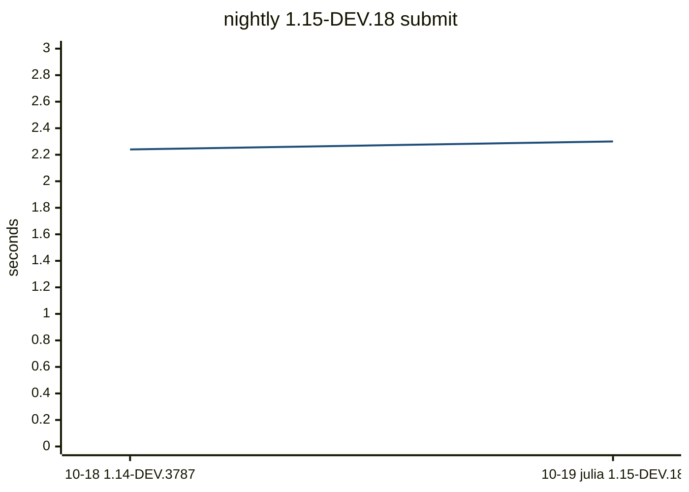


Latest `submit` methods:

| method | now ms | previous ms |
| --- | ---: | ---: |
| `Tuple{DistSSHQueue.var"#_entry_forward##0#_entry_forward##1"{DistSSHQueue.var"#_argv##0#_a...` | 5098.0 | 5069.4 |
| `Tuple{typeof(Core.kwcall), NamedTuple{(:kind, :quiet, :verbosity), Tuple{Symbol, Bool, Str...` | 493.8 | 491.7 |
| `Tuple{typeof(DistSSHQueue.main), Array{String, 1}}` | 234.8 | 212.0 |
| `Tuple{typeof(Core.kwcall), NamedTuple{(:kind,), Tuple{Symbol}}, typeof(DistSSHQueue.submit...` | 95.9 | 94.5 |
| `Tuple{typeof(DistSSHQueue.script_arg), String, String}` | 82.0 | 80.8 |
| `Tuple{typeof(DistSSHQueue.reject_worker_root_collision!), Array{DistSSHQueue.Job, 1}, Stri...` | 67.0 | 66.8 |
| `Tuple{typeof(DistSSHQueue.parse_host_cap), String}` | 47.2 | 45.8 |
| `Tuple{typeof(Distributed.flush_gc_msgs)}` | 22.5 | 22.7 |
| `Tuple{typeof(Core.kwcall), NamedTuple{(:kind,), Tuple{Symbol}}, typeof(DistSSHQueue.submit...` | 21.1 | 20.5 |
| `Tuple{Distributed.var"#start_gc_msgs_task##0#start_gc_msgs_task##1"}` | 14.0 | 14.1 |

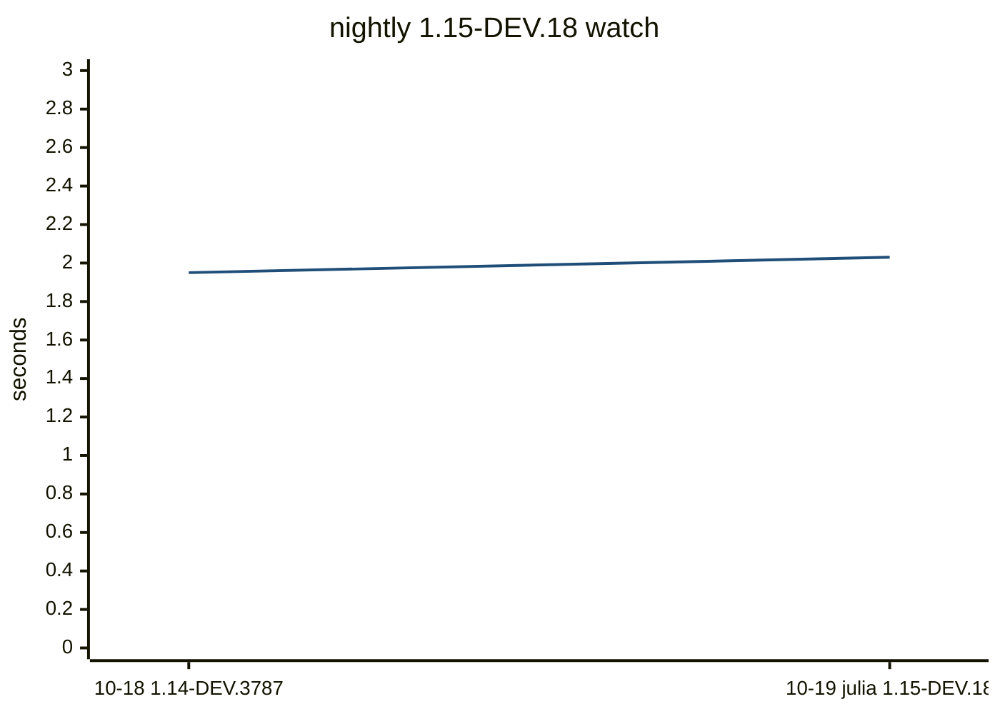


Latest `watch` methods:

| method | now ms | previous ms |
| --- | ---: | ---: |
| `Tuple{DistSSHQueue.var"#_entry_forward##0#_entry_forward##1"{DistSSHQueue.var"#_argv##0#_a...` | 4221.6 | 4086.9 |
| `Tuple{DistSSHQueue.var"##watch!#199", Float64, Int64, Base.PipeEndpoint, Nothing, Bool, No...` | 816.1 |  |
| `Tuple{typeof(DistSSHQueue.main), Array{String, 1}}` | 217.1 | 214.5 |
| `Tuple{typeof(Distributed.flush_gc_msgs)}` | 23.1 | 22.8 |
| `Tuple{typeof(Core.kwcall), NamedTuple{(:interval, :ticks, :quiet, :tail, :verbose), Tuple{...` | 14.9 | 15.2 |
| `Tuple{Distributed.var"#start_gc_msgs_task##0#start_gc_msgs_task##1"}` | 14.9 | 14.9 |
| `Tuple{Core.TypeEgal{NamedTuple{(:verb, :default_interval), T} where T<:Tuple}, Tuple{Strin...` | 6.6 | 6.6 |
| `Tuple{Base.var"##187#188", Vararg{Any, 4}}` | 3.8 | 3.8 |
| `Tuple{typeof(Base.should_use_main_entrypoint)}` | 2.9 | 2.8 |
| `Tuple{typeof(Base._array_for), Core.TypeEgal{DistSSHQueue.Job}, Array{Any, 1}, Base.HasSha...` | 1.9 | 37.3 |

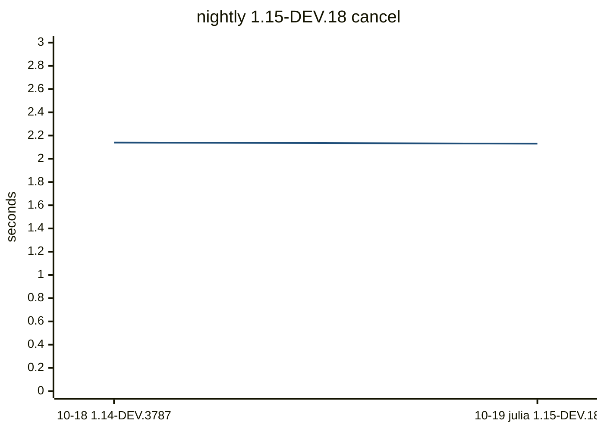


Latest `cancel` methods:

| method | now ms | previous ms |
| --- | ---: | ---: |
| `Tuple{DistSSHQueue.var"#_entry_forward##0#_entry_forward##1"{DistSSHQueue.var"#_argv##0#_a...` | 5081.8 | 5126.5 |
| `Tuple{typeof(DistSSHQueue.main), Array{String, 1}}` | 218.5 | 212.5 |
| `Tuple{typeof(DistSSHQueue._job_row), Base.Dict{String, Any}, String}` | 197.1 | 198.1 |
| `Tuple{typeof(DistSSHQueue._row_dt), String, String}` | 83.7 | 83.8 |
| `Tuple{Core.TypeEgal{Base.Dict{String, Any}}, Base.Generator{Base.Dict{String, Any}, DistSS...` | 28.7 | 28.8 |
| `Tuple{typeof(Distributed.flush_gc_msgs)}` | 23.0 | 23.7 |
| `Tuple{typeof(Core.kwcall), NamedTuple{(:id, :kind, :script, :hosts, :state, :queued_at, :s...` | 21.7 | 21.8 |
| `Tuple{Core.TypeEgal{Base.Dict{String, Any}}, Pair{String, String}, Pair{String, String}, P...` | 15.1 | 15.3 |
| `Tuple{Distributed.var"#start_gc_msgs_task##0#start_gc_msgs_task##1"}` | 14.8 | 14.9 |
| `Tuple{typeof(Base.iterate), Base.Dict{String, Any}}` | 12.3 | 12.4 |

