# Compile bench

Precompile time, load time, CLI wall time, `src/**/*.jl` size, and the host
(OS name, arch, CPU). `code lines` skips blank lines. A row is flagged when,
against the previous sample on the same Julia slot, the host OS or arch
changes, the Julia version changes, package precompile grows by 1.5x and 0.5s, a command wall grows
by 1.5x and 1s, or a method of at least 200 ms is new in the top 20 or
doubles. This does not fail CI.

## Flagged

No sample grew past the watch line.

## 1.13

| date | commit | version | julia | os | arch | src files | code lines | full s | pkg s | using s | help s | status s | submit s | watch s | cancel s |
| --- | --- | --- | --- | --- | --- | --- | --- | --- | --- | --- | --- | --- | --- | --- | --- |
| 2026-10-18 | 2ad75fb | 0.9.6 | 1.13.2 | Ubuntu 24.04.5 LTS | x86_64 | 24 | 6144 | 8.35 | 1.74 | 0.32 | 14.66 | 15.43 |  |  |  |
| 2026-10-18 | de4ef6e | 0.9.6 | 1.13.2 | Ubuntu 24.04.5 LTS | x86_64 | 24 | 6181 | 9.24 | 2.28 | 0.36 | 1.15 | 6.52 | 7.38 | 6.55 | 6.92 |
| 2026-10-19 | 860266c | 0.9.6 | 1.13.2 | Ubuntu 24.04.5 LTS | x86_64 | 24 | 6182 | 7.76 | 1.93 | 0.32 | 1.02 | 5.62 | 6.47 | 5.64 | 5.88 |
| 2026-10-19 | fbd948c | 0.9.7 | 1.13.2 | Ubuntu 24.04.5 LTS | x86_64 | 24 | 6182 | 8.81 | 2.16 | 0.34 | 1.08 | 6.25 | 7.08 | 6.2 | 6.45 |

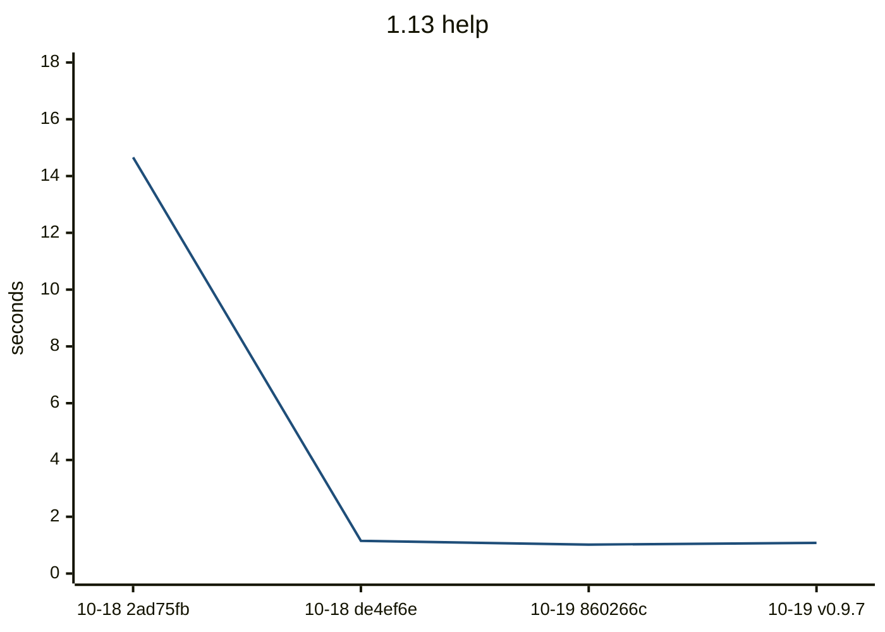


Latest `help` methods:

| method | now ms | previous ms |
| --- | ---: | ---: |
| `Tuple{typeof(DistSSHQueue.main), Array{String, 1}}` | 492.6 | 457.5 |
| `Tuple{typeof(Core.kwcall), NamedTuple{(:topic,), Tuple{Nothing}}, typeof(DistSSHQueue.prin...` | 51.4 | 49.9 |
| `Tuple{Distributed.var"#start_gc_msgs_task##0#start_gc_msgs_task##1"}` | 17.3 | 17.4 |
| `Tuple{typeof(Base.should_use_main_entrypoint)}` | 11.4 | 12.8 |
| `Tuple{typeof(Core.kwcall), NamedTuple{(:topic,), Tuple{Nothing}}, typeof(DistSSHQueue.prin...` | 3.8 | 4.2 |
| `Tuple{typeof(Base.getproperty), Base.Set{String}, Symbol}` | 3.4 | 3.5 |
| `Tuple{typeof(Base.something), Nothing, Symbol}` | 3.4 | 3.5 |
| `Tuple{typeof(Base.getproperty), Base.GenericCondition{Base.ReentrantLock}, Symbol}` | 3.2 | 3.4 |
| `Tuple{typeof(Base._cshp), Int64, Tuple{Bool}, Tuple{}, Tuple{Int64}}` | 3.0 | 3.2 |

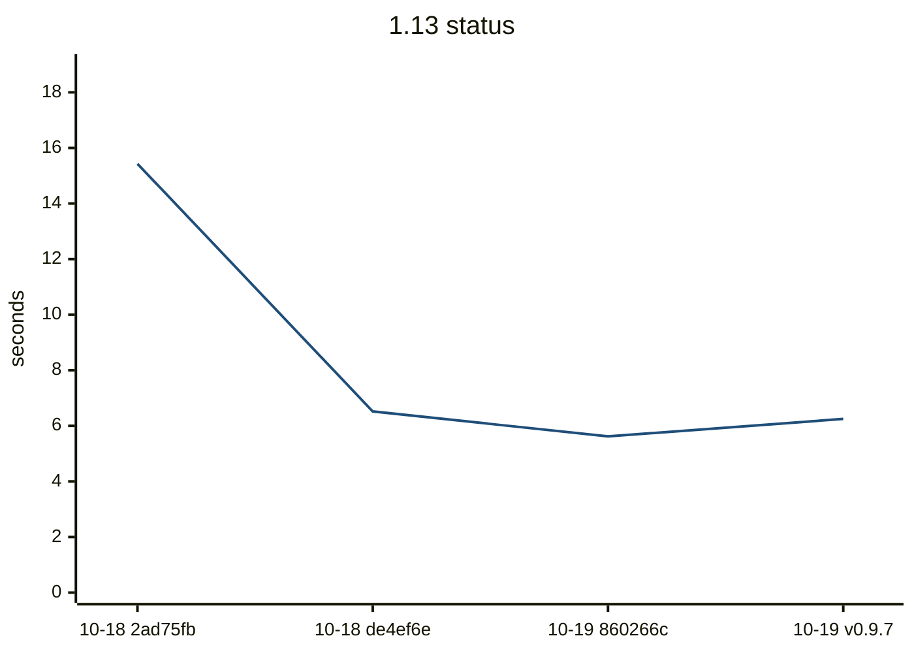


Latest `status` methods:

| method | now ms | previous ms |
| --- | ---: | ---: |
| `Tuple{DistSSHQueue.var"#_entry_forward##0#_entry_forward##1"{DistSSHQueue.var"#_argv##0#_a...` | 4303.4 | 3811.1 |
| `Tuple{DistSSHQueue.var"##show_status#195", Base.PipeEndpoint, Nothing, Bool, Nothing, Bool...` | 906.6 | 836.0 |
| `Tuple{typeof(DistSSHQueue.main), Array{String, 1}}` | 500.5 | 465.4 |
| `Tuple{Distributed.var"#start_gc_msgs_task##0#start_gc_msgs_task##1"}` | 18.0 | 17.7 |
| `Tuple{typeof(Core.kwcall), NamedTuple{(:quiet, :tail, :verbose), Tuple{Bool, Nothing, Bool...` | 13.5 | 13.0 |
| `Tuple{typeof(Base.should_use_main_entrypoint)}` | 11.4 | 12.7 |
| `Tuple{typeof(Base._array_for), Type{DistSSHQueue.Job}, Array{Any, 1}, Base.HasShape{1}}` | 7.0 | 6.3 |
| `Tuple{typeof(Base.getproperty), NamedTuple{(:quiet, :progress, :verbose, :yes, :hosts_file...` | 5.3 | 5.5 |
| `Tuple{typeof(Base.map), Base.var"#append!##0#append!##1"{String}, NTuple{10, String}}` | 4.8 | 4.3 |
| `Tuple{Dates.var"##34#35", Vararg{Any, 5}}` | 4.7 | 4.5 |

```mermaid
---
config:
  theme: base
  themeVariables:
    xyChart:
      plotColorPalette: "#1f4e79"
  xyChart:
    xAxis:
      labelRotation: 45
---
xychart-beta
    title "1.13 submit"
    x-axis ["10-18 de4ef6e", "10-19 860266c", "10-19 v0.9.7"]
    y-axis "seconds" 0 --> 9
    line [7.38, 6.47, 7.08]
```


Latest `submit` methods:

| method | now ms | previous ms |
| --- | ---: | ---: |
| `Tuple{DistSSHQueue.var"#_entry_forward##0#_entry_forward##1"{DistSSHQueue.var"#_argv##0#_a...` | 5070.2 | 4545.9 |
| `Tuple{typeof(Core.kwcall), NamedTuple{(:kind, :quiet, :verbosity), Tuple{Symbol, Bool, Str...` | 545.6 | 508.2 |
| `Tuple{typeof(DistSSHQueue.main), Array{String, 1}}` | 504.5 | 456.5 |
| `Tuple{typeof(Core.kwcall), NamedTuple{(:kind,), Tuple{Symbol}}, typeof(DistSSHQueue.submit...` | 109.2 | 103.6 |
| `Tuple{typeof(DistSSHQueue.script_arg), String, String}` | 88.5 | 82.3 |
| `Tuple{typeof(DistSSHQueue.reject_worker_root_collision!), Array{DistSSHQueue.Job, 1}, Stri...` | 60.6 | 59.4 |
| `Tuple{typeof(DistSSHQueue.parse_host_cap), String}` | 50.4 | 44.5 |
| `Tuple{typeof(Core.kwcall), NamedTuple{(:kind,), Tuple{Symbol}}, typeof(DistSSHQueue.submit...` | 22.4 | 21.0 |
| `Tuple{Distributed.var"#start_gc_msgs_task##0#start_gc_msgs_task##1"}` | 17.7 | 17.5 |
| `Tuple{typeof(Core.kwcall), NamedTuple{(:indent, :sorted, :by, :inline_tables), Tuple{Int64...` | 14.8 | 13.9 |

```mermaid
---
config:
  theme: base
  themeVariables:
    xyChart:
      plotColorPalette: "#1f4e79"
  xyChart:
    xAxis:
      labelRotation: 45
---
xychart-beta
    title "1.13 watch"
    x-axis ["10-18 de4ef6e", "10-19 860266c", "10-19 v0.9.7"]
    y-axis "seconds" 0 --> 8
    line [6.55, 5.64, 6.2]
```


Latest `watch` methods:

| method | now ms | previous ms |
| --- | ---: | ---: |
| `Tuple{DistSSHQueue.var"#_entry_forward##0#_entry_forward##1"{DistSSHQueue.var"#_argv##0#_a...` | 4127.5 | 3785.7 |
| `Tuple{DistSSHQueue.var"##watch!#199", Float64, Int64, Base.PipeEndpoint, Nothing, Bool, No...` | 949.0 | 864.3 |
| `Tuple{typeof(DistSSHQueue.main), Array{String, 1}}` | 494.6 | 457.7 |
| `Tuple{Distributed.var"#start_gc_msgs_task##0#start_gc_msgs_task##1"}` | 19.3 | 17.4 |
| `Tuple{typeof(Core.kwcall), NamedTuple{(:interval, :ticks, :quiet, :tail, :verbose), Tuple{...` | 17.0 | 16.1 |
| `Tuple{typeof(Base.should_use_main_entrypoint)}` | 11.4 | 12.4 |
| `Tuple{typeof(Base._array_for), Type{DistSSHQueue.Job}, Array{Any, 1}, Base.HasShape{1}}` | 7.5 | 6.3 |
| `Tuple{typeof(Base.getproperty), NamedTuple{(:quiet, :progress, :verbose, :yes, :hosts_file...` | 5.3 | 5.4 |
| `Tuple{typeof(Base.map), Base.var"#append!##0#append!##1"{String}, NTuple{10, String}}` | 4.6 | 4.0 |
| `Tuple{Dates.var"##34#35", Vararg{Any, 5}}` | 4.5 | 4.5 |

```mermaid
---
config:
  theme: base
  themeVariables:
    xyChart:
      plotColorPalette: "#1f4e79"
  xyChart:
    xAxis:
      labelRotation: 45
---
xychart-beta
    title "1.13 cancel"
    x-axis ["10-18 de4ef6e", "10-19 860266c", "10-19 v0.9.7"]
    y-axis "seconds" 0 --> 9
    line [6.92, 5.88, 6.45]
```


Latest `cancel` methods:

| method | now ms | previous ms |
| --- | ---: | ---: |
| `Tuple{DistSSHQueue.var"#_entry_forward##0#_entry_forward##1"{DistSSHQueue.var"#_argv##0#_a...` | 5087.1 | 4622.3 |
| `Tuple{typeof(DistSSHQueue.main), Array{String, 1}}` | 507.5 | 452.3 |
| `Tuple{typeof(DistSSHQueue._row_dt), String, String}` | 87.1 | 76.2 |
| `Tuple{typeof(DistSSHQueue._job_row), Base.Dict{String, Any}, String}` | 57.5 | 51.6 |
| `Tuple{Type{Base.Dict{String, Any}}, Base.Generator{Base.Dict{String, Any}, DistSSHQueue.va...` | 29.2 | 27.3 |
| `Tuple{typeof(Core.kwcall), NamedTuple{(:id, :kind, :script, :hosts, :state, :queued_at, :s...` | 22.6 | 21.0 |
| `Tuple{Distributed.var"#start_gc_msgs_task##0#start_gc_msgs_task##1"}` | 18.0 | 17.7 |
| `Tuple{typeof(Core.kwcall), NamedTuple{(:indent, :sorted, :by, :inline_tables), Tuple{Int64...` | 15.4 | 13.9 |
| `Tuple{typeof(Base.should_use_main_entrypoint)}` | 11.6 | 12.4 |
| `Tuple{typeof(Base.iterate), Base.Dict{String, Any}}` | 11.1 | 10.2 |

## 1.14-nightly

| date | commit | version | julia | os | arch | src files | code lines | full s | pkg s | using s | help s | status s | submit s | watch s | cancel s |
| --- | --- | --- | --- | --- | --- | --- | --- | --- | --- | --- | --- | --- | --- | --- | --- |
| 2026-10-18 | 2ad75fb | 0.9.6 | 1.14.0-DEV.3787 | Ubuntu 24.04.5 LTS | x86_64 | 24 | 6144 | 4.42 | 0.98 | 0.24 | 4.2 | 4.33 |  |  |  |
| 2026-10-18 | de4ef6e | 0.9.6 | 1.14.0-DEV.3787 | Ubuntu 24.04.5 LTS | x86_64 | 24 | 6181 | 6.96 | 1.84 | 0.33 | 0.71 | 1.82 | 2.12 | 1.76 | 1.93 |
| 2026-10-19 | 860266c | 0.9.6 | 1.14.0-DEV.3787 | Ubuntu 24.04.5 LTS | x86_64 | 24 | 6182 | 5.19 | 1.35 | 0.26 | 0.62 | 1.44 | 1.67 | 1.47 | 1.51 |
| 2026-10-19 | fbd948c | 0.9.7 | 1.14.0-DEV.3787 | Ubuntu 24.04.5 LTS | x86_64 | 24 | 6182 | 5.3 | 1.42 | 0.33 | 0.64 | 1.63 | 1.58 | 1.4 | 1.52 |

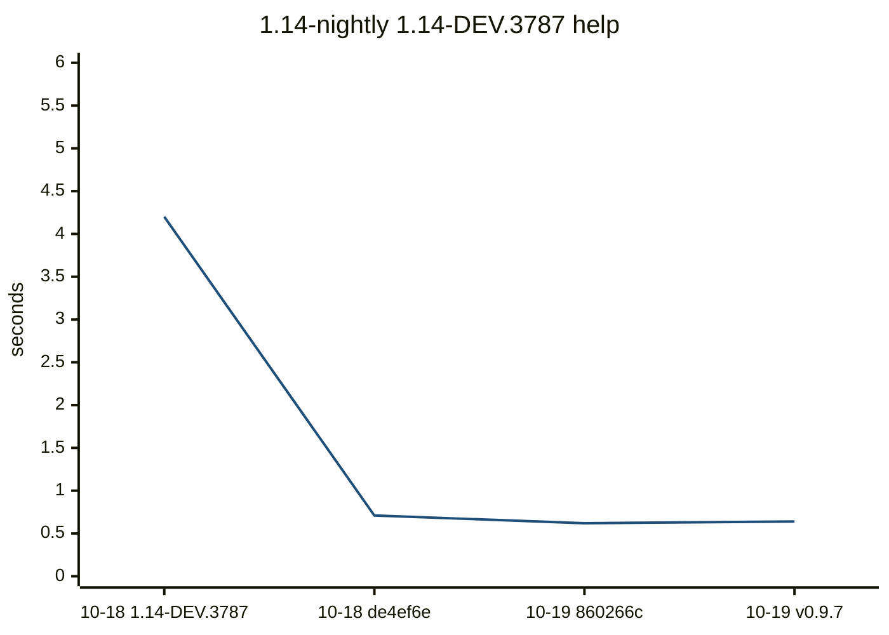


Latest `help` methods:

| method | now ms | previous ms |
| --- | ---: | ---: |
| `Tuple{typeof(DistSSHQueue.main), Array{String, 1}}` | 360.3 | 352.9 |
| `Tuple{typeof(Core.kwcall), NamedTuple{(:topic,), Tuple{Nothing}}, typeof(DistSSHQueue.prin...` | 38.6 | 39.2 |
| `Tuple{typeof(Distributed.flush_gc_msgs)}` | 17.8 | 18.1 |
| `Tuple{Distributed.var"#start_gc_msgs_task##0#start_gc_msgs_task##1"}` | 12.0 | 12.3 |
| `Tuple{typeof(Base.should_use_main_entrypoint)}` | 11.8 | 12.1 |
| `Tuple{typeof(Base.string), Char}` | 6.1 | 6.1 |
| `Tuple{typeof(Base.tail), NTuple{15, String}}` | 5.1 | 5.1 |
| `Tuple{typeof(Core.kwcall), NamedTuple{(:topic,), Tuple{Nothing}}, typeof(DistSSHQueue.prin...` | 4.5 | 4.7 |
| `Tuple{typeof(Base.tail), NTuple{14, String}}` | 4.2 | 3.9 |
| `Tuple{typeof(Base._cshp), Int64, Tuple{Bool}, Tuple{}, Tuple{Int64}}` | 4.1 | 3.9 |

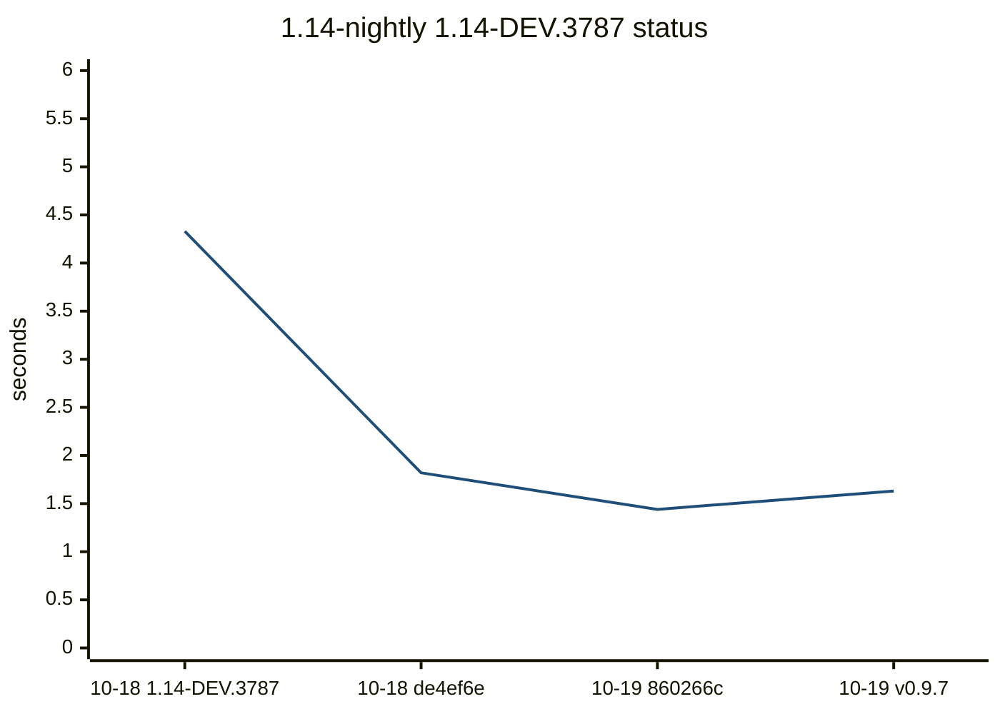


Latest `status` methods:

| method | now ms | previous ms |
| --- | ---: | ---: |
| `Tuple{DistSSHQueue.var"#_entry_forward##0#_entry_forward##1"{DistSSHQueue.var"#_argv##0#_a...` | 3180.0 | 2997.6 |
| `Tuple{DistSSHQueue.var"##show_status#195", Base.PipeEndpoint, Nothing, Bool, Nothing, Bool...` | 595.9 | 542.1 |
| `Tuple{typeof(DistSSHQueue.main), Array{String, 1}}` | 173.4 | 172.1 |
| `Tuple{typeof(Distributed.flush_gc_msgs)}` | 18.8 | 17.7 |
| `Tuple{Distributed.var"#start_gc_msgs_task##0#start_gc_msgs_task##1"}` | 12.2 | 11.5 |
| `Tuple{typeof(Core.kwcall), NamedTuple{(:quiet, :tail, :verbose), Tuple{Bool, Nothing, Bool...` | 9.7 | 9.3 |
| `Tuple{typeof(Base.getproperty), NamedTuple{(:quiet, :progress, :verbose, :yes, :hosts_file...` | 8.0 | 7.8 |
| `Tuple{typeof(Base.map), Base.var"#append!##0#append!##1"{String}, NTuple{10, String}}` | 7.0 | 6.4 |
| `Tuple{typeof(Base._array_for), Core.TypeEgal{DistSSHQueue.Job}, Array{Any, 1}, Base.HasSha...` | 6.7 | 6.2 |
| `Tuple{typeof(DistSSHQueue._q_cell), String, Int64}` | 5.1 | 5.0 |

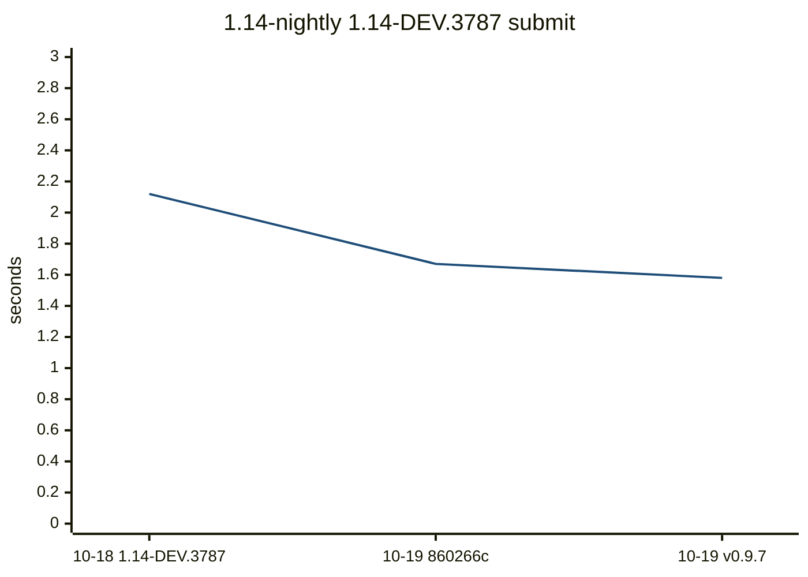


Latest `submit` methods:

| method | now ms | previous ms |
| --- | ---: | ---: |
| `Tuple{DistSSHQueue.var"#_entry_forward##0#_entry_forward##1"{DistSSHQueue.var"#_argv##0#_a...` | 3639.0 | 3624.4 |
| `Tuple{typeof(Core.kwcall), NamedTuple{(:kind, :quiet, :verbosity), Tuple{Symbol, Bool, Str...` | 341.5 | 345.9 |
| `Tuple{typeof(DistSSHQueue.main), Array{String, 1}}` | 168.3 | 167.7 |
| `Tuple{typeof(Core.kwcall), NamedTuple{(:kind,), Tuple{Symbol}}, typeof(DistSSHQueue.submit...` | 69.8 | 72.1 |
| `Tuple{typeof(DistSSHQueue.script_arg), String, String}` | 55.6 | 56.8 |
| `Tuple{typeof(DistSSHQueue.reject_worker_root_collision!), Array{DistSSHQueue.Job, 1}, Stri...` | 48.1 | 46.9 |
| `Tuple{typeof(DistSSHQueue.parse_host_cap), String}` | 32.3 | 33.5 |
| `Tuple{typeof(Distributed.flush_gc_msgs)}` | 17.4 | 17.5 |
| `Tuple{typeof(Core.kwcall), NamedTuple{(:kind,), Tuple{Symbol}}, typeof(DistSSHQueue.submit...` | 17.0 | 17.1 |
| `Tuple{Distributed.var"#start_gc_msgs_task##0#start_gc_msgs_task##1"}` | 10.5 | 11.6 |

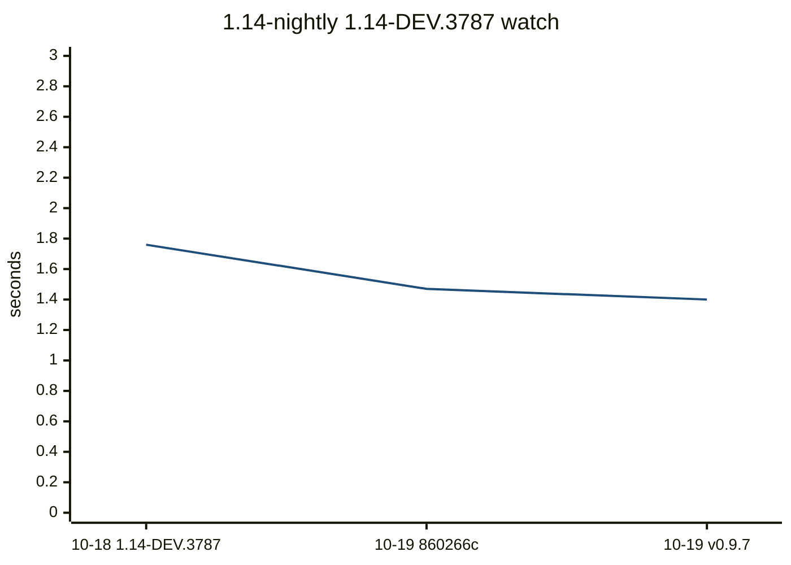


Latest `watch` methods:

| method | now ms | previous ms |
| --- | ---: | ---: |
| `Tuple{DistSSHQueue.var"#_entry_forward##0#_entry_forward##1"{DistSSHQueue.var"#_argv##0#_a...` | 2816.1 | 2898.8 |
| `Tuple{DistSSHQueue.var"##watch!#199", Float64, Int64, Base.PipeEndpoint, Nothing, Bool, No...` | 554.0 | 597.0 |
| `Tuple{typeof(DistSSHQueue.main), Array{String, 1}}` | 162.0 | 172.1 |
| `Tuple{typeof(Distributed.flush_gc_msgs)}` | 16.6 | 18.2 |
| `Tuple{Distributed.var"#start_gc_msgs_task##0#start_gc_msgs_task##1"}` | 11.6 | 12.2 |
| `Tuple{typeof(Core.kwcall), NamedTuple{(:interval, :ticks, :quiet, :tail, :verbose), Tuple{...` | 11.5 | 12.6 |
| `Tuple{Core.TypeEgal{NamedTuple{(:verb, :default_interval), T} where T<:Tuple}, Tuple{Strin...` | 6.6 | 6.2 |
| `Tuple{typeof(Base.should_use_main_entrypoint)}` | 2.9 | 3.0 |
| `Tuple{Base.var"##187#188", Vararg{Any, 4}}` | 2.9 | 2.9 |
| `Tuple{typeof(Base._array_for), Core.TypeEgal{DistSSHQueue.Job}, Array{Any, 1}, Base.HasSha...` | 1.7 | 1.8 |

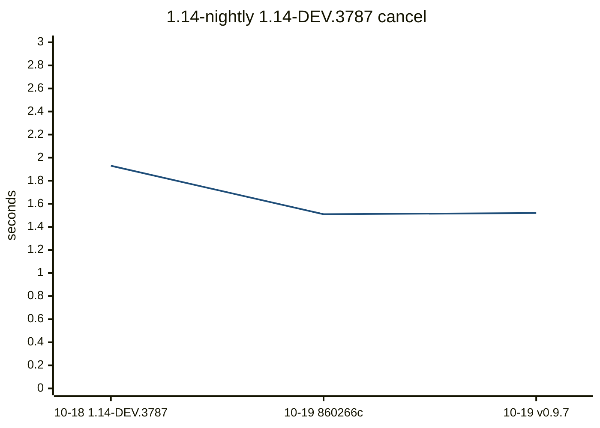


Latest `cancel` methods:

| method | now ms | previous ms |
| --- | ---: | ---: |
| `Tuple{DistSSHQueue.var"#_entry_forward##0#_entry_forward##1"{DistSSHQueue.var"#_argv##0#_a...` | 3562.0 | 3560.7 |
| `Tuple{typeof(DistSSHQueue.main), Array{String, 1}}` | 156.9 | 162.5 |
| `Tuple{typeof(DistSSHQueue._job_row), Base.Dict{String, Any}, String}` | 120.9 | 116.8 |
| `Tuple{typeof(DistSSHQueue._row_dt), String, String}` | 52.3 | 52.0 |
| `Tuple{Core.TypeEgal{Base.Dict{String, Any}}, Base.Generator{Base.Dict{String, Any}, DistSS...` | 21.7 | 21.3 |
| `Tuple{typeof(Distributed.flush_gc_msgs)}` | 19.6 | 17.6 |
| `Tuple{typeof(Core.kwcall), NamedTuple{(:id, :kind, :script, :hosts, :state, :queued_at, :s...` | 17.5 | 17.5 |
| `Tuple{Core.TypeEgal{Base.Dict{String, Any}}, Pair{String, String}, Pair{String, String}, P...` | 12.3 | 12.5 |
| `Tuple{Distributed.var"#start_gc_msgs_task##0#start_gc_msgs_task##1"}` | 12.0 | 11.6 |
| `Tuple{typeof(Base.iterate), Base.Dict{String, Any}}` | 10.3 | 10.1 |

## nightly

| date | commit | version | julia | os | arch | src files | code lines | full s | pkg s | using s | help s | status s | submit s | watch s | cancel s |
| --- | --- | --- | --- | --- | --- | --- | --- | --- | --- | --- | --- | --- | --- | --- | --- |
| 2026-10-18 | de4ef6e | 0.9.6 | 1.14.0-DEV.3787 | Ubuntu 24.04.5 LTS | x86_64 | 24 | 6181 | 7.99 | 2.09 | 0.35 | 0.77 | 2.0 | 2.24 | 1.95 | 2.14 |
| 2026-10-19 | 860266c | 0.9.6 | 1.15.0-DEV.18 | Ubuntu 24.04.5 LTS | x86_64 | 24 | 6182 | 8.26 | 2.12 | 0.35 | 0.77 | 2.05 | 2.3 | 2.03 | 2.13 |
| 2026-10-19 | fbd948c | 0.9.7 | 1.15.0-DEV.18 | Ubuntu 24.04.5 LTS | x86_64 | 24 | 6182 | 8.16 | 2.1 | 0.36 | 0.77 | 2.03 | 2.34 | 2.01 | 2.16 |

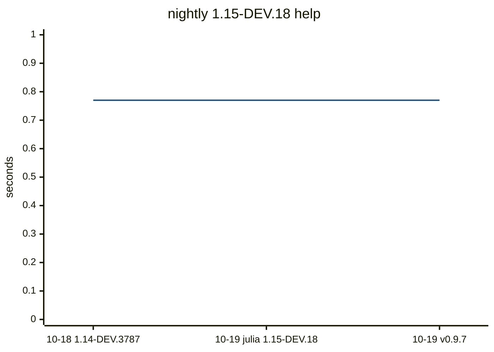


Latest `help` methods:

| method | now ms | previous ms |
| --- | ---: | ---: |
| `Tuple{typeof(DistSSHQueue.main), Array{String, 1}}` | 468.0 | 473.7 |
| `Tuple{typeof(Core.kwcall), NamedTuple{(:topic,), Tuple{Nothing}}, typeof(DistSSHQueue.prin...` | 51.5 | 52.2 |
| `Tuple{typeof(Distributed.flush_gc_msgs)}` | 22.3 | 23.0 |
| `Tuple{Distributed.var"#start_gc_msgs_task##0#start_gc_msgs_task##1"}` | 14.8 | 14.8 |
| `Tuple{typeof(Base.should_use_main_entrypoint)}` | 13.3 | 15.5 |
| `Tuple{typeof(Base.string), Char}` | 6.3 | 6.5 |
| `Tuple{typeof(Base.tail), NTuple{15, String}}` | 4.9 | 5.3 |
| `Tuple{typeof(Core.kwcall), NamedTuple{(:topic,), Tuple{Nothing}}, typeof(DistSSHQueue.prin...` | 4.3 | 4.7 |
| `Tuple{typeof(Base._cshp), Int64, Tuple{Bool}, Tuple{}, Tuple{Int64}}` | 4.0 | 3.9 |
| `Tuple{typeof(Base.tail), NTuple{14, String}}` | 4.0 | 4.0 |

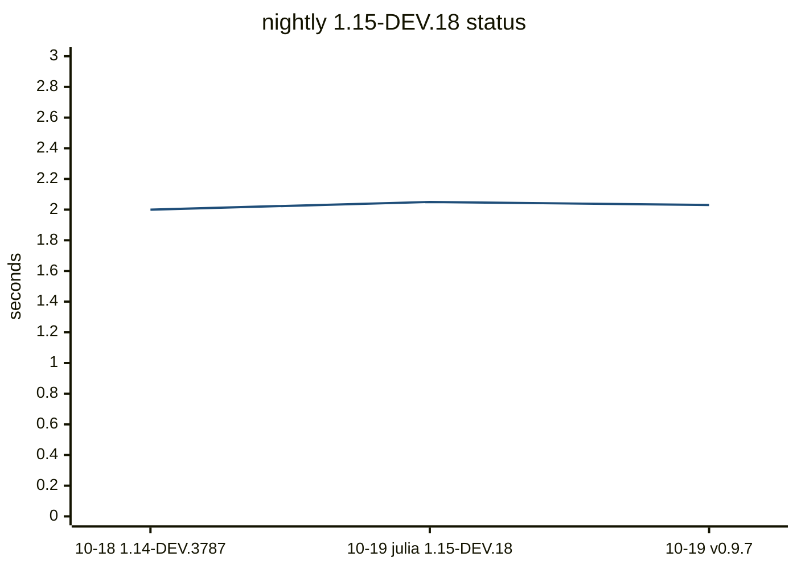


Latest `status` methods:

| method | now ms | previous ms |
| --- | ---: | ---: |
| `Tuple{DistSSHQueue.var"#_entry_forward##0#_entry_forward##1"{DistSSHQueue.var"#_argv##0#_a...` | 4287.0 | 4318.7 |
| `Tuple{DistSSHQueue.var"##show_status#195", Base.PipeEndpoint, Nothing, Bool, Nothing, Bool...` | 778.8 | 786.2 |
| `Tuple{typeof(DistSSHQueue.main), Array{String, 1}}` | 216.7 | 213.4 |
| `Tuple{typeof(Distributed.flush_gc_msgs)}` | 23.0 | 22.2 |
| `Tuple{Distributed.var"#start_gc_msgs_task##0#start_gc_msgs_task##1"}` | 14.6 | 14.1 |
| `Tuple{typeof(Core.kwcall), NamedTuple{(:quiet, :tail, :verbose), Tuple{Bool, Nothing, Bool...` | 10.6 | 10.6 |
| `Tuple{typeof(Base.getproperty), NamedTuple{(:quiet, :progress, :verbose, :yes, :hosts_file...` | 8.8 | 9.0 |
| `Tuple{typeof(Base._array_for), Core.TypeEgal{DistSSHQueue.Job}, Array{Any, 1}, Base.HasSha...` | 7.3 | 7.0 |
| `Tuple{typeof(Base.map), Base.var"#append!##0#append!##1"{String}, NTuple{10, String}}` | 7.0 | 7.1 |
| `Tuple{typeof(DistSSHQueue._q_cell), String, Int64}` | 5.1 | 5.1 |

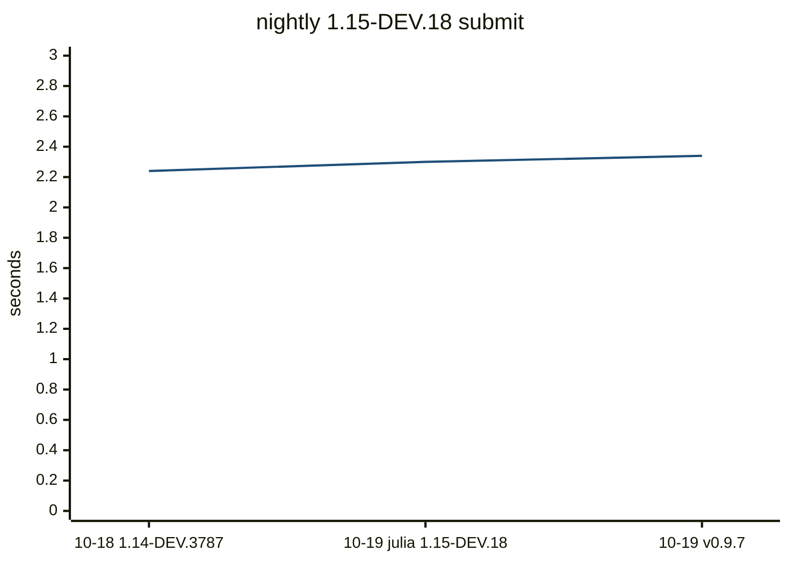


Latest `submit` methods:

| method | now ms | previous ms |
| --- | ---: | ---: |
| `Tuple{DistSSHQueue.var"#_entry_forward##0#_entry_forward##1"{DistSSHQueue.var"#_argv##0#_a...` | 5138.6 | 5098.0 |
| `Tuple{typeof(Core.kwcall), NamedTuple{(:kind, :quiet, :verbosity), Tuple{Symbol, Bool, Str...` | 500.0 | 493.8 |
| `Tuple{typeof(DistSSHQueue.main), Array{String, 1}}` | 218.1 | 234.8 |
| `Tuple{typeof(Core.kwcall), NamedTuple{(:kind,), Tuple{Symbol}}, typeof(DistSSHQueue.submit...` | 98.1 | 95.9 |
| `Tuple{typeof(DistSSHQueue.script_arg), String, String}` | 84.1 | 82.0 |
| `Tuple{typeof(DistSSHQueue.reject_worker_root_collision!), Array{DistSSHQueue.Job, 1}, Stri...` | 67.5 | 67.0 |
| `Tuple{typeof(DistSSHQueue.parse_host_cap), String}` | 47.4 | 47.2 |
| `Tuple{typeof(Distributed.flush_gc_msgs)}` | 23.1 | 22.5 |
| `Tuple{typeof(Core.kwcall), NamedTuple{(:kind,), Tuple{Symbol}}, typeof(DistSSHQueue.submit...` | 22.0 | 21.1 |
| `Tuple{Distributed.var"#start_gc_msgs_task##0#start_gc_msgs_task##1"}` | 15.1 | 14.0 |

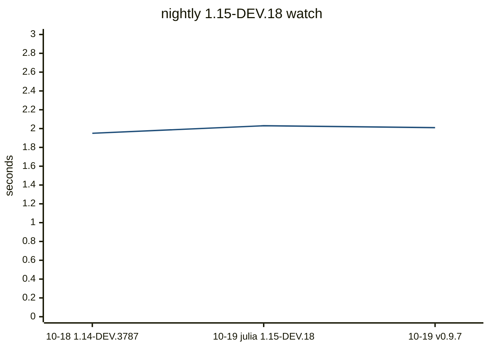


Latest `watch` methods:

| method | now ms | previous ms |
| --- | ---: | ---: |
| `Tuple{DistSSHQueue.var"#_entry_forward##0#_entry_forward##1"{DistSSHQueue.var"#_argv##0#_a...` | 4172.3 | 4221.6 |
| `Tuple{DistSSHQueue.var"##watch!#199", Float64, Int64, Base.PipeEndpoint, Nothing, Bool, No...` | 823.1 | 816.1 |
| `Tuple{typeof(DistSSHQueue.main), Array{String, 1}}` | 215.9 | 217.1 |
| `Tuple{typeof(Distributed.flush_gc_msgs)}` | 22.3 | 23.1 |
| `Tuple{typeof(Core.kwcall), NamedTuple{(:interval, :ticks, :quiet, :tail, :verbose), Tuple{...` | 15.0 | 14.9 |
| `Tuple{Distributed.var"#start_gc_msgs_task##0#start_gc_msgs_task##1"}` | 14.8 | 14.9 |
| `Tuple{Core.TypeEgal{NamedTuple{(:verb, :default_interval), T} where T<:Tuple}, Tuple{Strin...` | 6.6 | 6.6 |
| `Tuple{Base.var"##187#188", Vararg{Any, 4}}` | 3.8 | 3.8 |
| `Tuple{typeof(Base.should_use_main_entrypoint)}` | 2.9 | 2.9 |
| `Tuple{typeof(Base._array_for), Core.TypeEgal{DistSSHQueue.Job}, Array{Any, 1}, Base.HasSha...` | 1.9 | 1.9 |

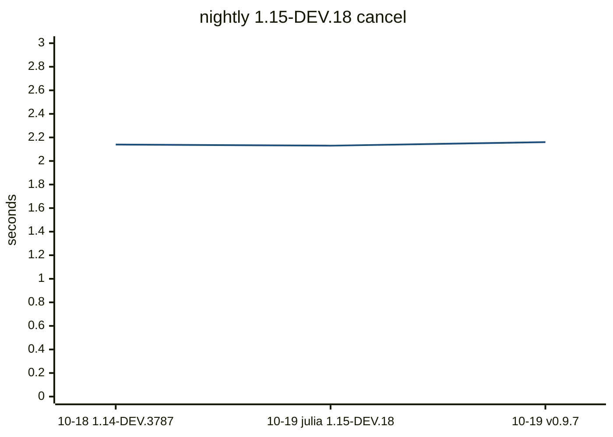


Latest `cancel` methods:

| method | now ms | previous ms |
| --- | ---: | ---: |
| `Tuple{DistSSHQueue.var"#_entry_forward##0#_entry_forward##1"{DistSSHQueue.var"#_argv##0#_a...` | 5124.8 | 5081.8 |
| `Tuple{typeof(DistSSHQueue.main), Array{String, 1}}` | 224.4 | 218.5 |
| `Tuple{typeof(DistSSHQueue._job_row), Base.Dict{String, Any}, String}` | 197.8 | 197.1 |
| `Tuple{typeof(DistSSHQueue._row_dt), String, String}` | 82.4 | 83.7 |
| `Tuple{Core.TypeEgal{Base.Dict{String, Any}}, Base.Generator{Base.Dict{String, Any}, DistSS...` | 28.3 | 28.7 |
| `Tuple{typeof(Distributed.flush_gc_msgs)}` | 22.7 | 23.0 |
| `Tuple{typeof(Core.kwcall), NamedTuple{(:id, :kind, :script, :hosts, :state, :queued_at, :s...` | 21.4 | 21.7 |
| `Tuple{Core.TypeEgal{Base.Dict{String, Any}}, Pair{String, String}, Pair{String, String}, P...` | 15.0 | 15.1 |
| `Tuple{Distributed.var"#start_gc_msgs_task##0#start_gc_msgs_task##1"}` | 14.6 | 14.8 |
| `Tuple{typeof(Base.iterate), Base.Dict{String, Any}}` | 12.4 | 12.3 |

